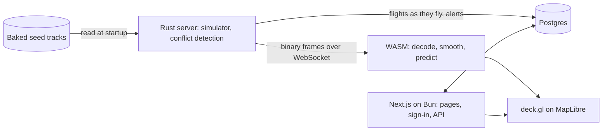

# atcdemo

A real-time air traffic picture, built to stay at 60 fps from everyday traffic up to 50,000+ aircraft. It replays recorded real flights from [adsb.lol's daily archive](https://github.com/adsblol/globe_history). It covers the continental United States, about 8,000 aircraft in the air at once.

> **Status: milestone 1, scaffold.** The backend starts with `docker compose up` and the page loads a WASM module, but there is no map yet. The full design is in [docs/DESIGN.md](docs/DESIGN.md).

## Quick start

You need [Docker](https://docs.docker.com/get-docker/) and [mise](https://mise.jdx.dev). mise installs the rest.

```bash
mise install              # Bun, Rust and wasm-pack, at the pinned versions
cp .env.example .env      # the defaults work as they stand
docker compose up -d      # Postgres, database setup and atc-server
bun install
bun dev                   # the web app, at http://localhost:3000
```

Open <http://localhost:3000>. The page shows a line computed in WASM. To check the backend, `curl http://localhost:8080/healthz` should answer `ok`.

If port 5432 or 8080 is already in use, see [Ports](#ports). To stop the backend, run `docker compose down`.

**Contents:** [What it will do](#what-it-will-do) · [How it is built](#how-it-is-built) · [Development](#development) · [Roadmap](#roadmap) · [Licence](#licence)

## What it will do

- Show live-looking traffic on a MapLibre map, in 2D and 3D, by replaying recorded real ADS-B tracks.
- Predict each aircraft's path up to 20 minutes ahead, with a timeline to scrub through the predicted picture.
- Detect and flag predicted conflicts between en-route aircraft (pairs coming within 5 nm laterally and 1,000 ft vertically).
- Draw airspace: Class B shelves as 3D volumes, and ARTCC boundaries.
- Provide a sortable flight list, flight search and a detail panel synced with the map.
- Multiply traffic in a stress mode, with an on-screen readout of frame rate and decode time.
- Require sign-in.

The app is watch-only: aircraft always follow their recorded paths.

## How it is built

| Part | Technology |
|---|---|
| Real-time server | Rust (axum, tokio): a simulator that replays recorded tracks, conflict detection, a recorder that writes each flight to the database as it flies, and the WebSocket |
| Transport | WebSocket with binary frames, filtered to each client's viewport |
| Shared core | One Rust crate for the wire format, prediction and conflict maths, compiled natively for the server and to WASM for the browser |
| Web app and API | Next.js, React, TypeScript, Drizzle, Zustand, TanStack Query, Tailwind CSS, shadcn/ui, running on Bun |
| Map and rendering | MapLibre GL JS with deck.gl layers reading typed arrays straight from WASM memory |
| Auth | Better Auth, with a short-lived signed token the Rust server verifies |
| Database | Postgres for accounts, saved views, preferences, alert history and the history of flights as they are flown |



## Development

### Tools

`mise install` reads `mise.toml` and installs everything in this table except Docker.

| Tool | Version | Used for | Installed by |
|---|---|---|---|
| Docker with Compose v2 | any recent | Postgres, the setup step and `atc-server` | You. `docker compose`, not the older `docker-compose` |
| [Bun](https://bun.com) | 1.4.5 | The web app, the tools and the scripts in `package.json` | `mise install`. The production build of the web app crashes on Bun 1.3.8 |
| [Rust](https://rustup.rs) | stable, with `rustfmt`, `clippy` and the `wasm32-unknown-unknown` target | The WASM package, and `atc-server` when run outside Docker | `mise install`, through `rustup` |
| [`wasm-pack`](https://github.com/wasm-bindgen/wasm-pack) | 0.15.1 | Building the WASM package | `mise install`, as a prebuilt binary |


Without mise, install the three yourself: Bun 1.4.5; Rust with `rustup`, then `rustup toolchain install` in the repo, which reads `rust-toolchain.toml`; and `cargo install wasm-pack --version 0.15.1 --locked`.

CI and the Docker images do not use mise, so each version is also pinned where they read it: `packageManager` in `package.json`, `rust-toolchain.toml`, and `WASM_PACK_VERSION` in `.github/workflows/ci.yml`. Change a version in both places.

### Configuration

Every process reads its configuration from environment variables at run time. Copying `.env.example` to `.env` is enough for a local run; the file describes each variable, and `.env` is not committed.

- The web app's scripts (`dev`, `start`, `test`, `db:migrate`) read `.env` from the repo root. Variables already set in the environment win over the file.
- The web app and `atc-server` both check their configuration at startup. If a required variable is missing or malformed, the process stops and names it.
- GitHub sign-in is optional. Leave `GITHUB_CLIENT_ID` and `GITHUB_CLIENT_SECRET` empty and the app offers only the demo accounts. To turn it on, create an OAuth app at <https://github.com/settings/developers> with the callback URL `http://localhost:3000/api/auth/callback/github` and set both.
- The secret and the demo passwords in `.env.example` are public. Replace them anywhere but a local run.

### The backend

`docker compose up` starts Postgres, runs a one-shot `setup` service that applies the database migrations, then starts `atc-server`. `GET /healthz` on `atc-server` answers `200 ok` when it can reach the database and `503` when it cannot.

| Command | What it does |
|---|---|
| `docker compose up -d` | Starts the backend in the background. Leave out `-d` to watch the logs |
| `docker compose up -d --build` | The same, after rebuilding the images. Use it after changing Rust code or a migration |
| `docker compose down` | Stops everything and keeps the database |
| `docker compose down -v` | Stops everything and deletes the database volume, so the next `up` starts from nothing |

Still planned: `docker compose --profile full up` will run the web app in a container too, so one command starts everything.

### The command-line client

`atc-cli` watches `atc-server`'s stream without a browser. It connects, says hello and prints one line per tick: `seq`, sim time, how many aircraft the frame holds, how many of them are new, and the size in bytes. A line also says when ticks were skipped and when a new pass begins. The totals are printed when it stops. It needs `atc-server` to run with `ATC_AUTH=off`, since it cannot send a token yet.

```bash
cargo run -p atc-cli -- --frames 10                 # ten ticks of the whole picture
cargo run -p atc-cli -- --dump 3                    # until Ctrl-C, with three aircraft under each tick
cargo run -p atc-cli -- --viewport -80,38,-70,43    # only this box: west,south,east,north
```

| Option | What it does |
|---|---|
| `--url <URL>` | The server's socket. The default is `ws://localhost:8080/ws` |
| `--viewport <W,S,E,N>` | Asks for the aircraft in this box only, in degrees. `--zoom <ZOOM>` sets the zoom sent with it, 6 by default |
| `--select <ID>` | Selects an aircraft id, so it keeps streaming outside the viewport |
| `--track <ID>` | Asks for the track an aircraft id has flown so far |
| `--frames <N>` | Stops after N ticks. Without it the client runs until Ctrl-C |
| `--dump <N>` | Also prints N decoded aircraft from every tick: callsign, type, position, altitude in feet above mean sea level, barometric altitude after `baro`, speed, track and vertical rate |

It exits with 0 after `--frames` ticks or Ctrl-C, with 1 when it cannot connect, the server closes the connection or a frame does not decode, and with 2 when the arguments are wrong.

### Ports

| Port | Used by | To change it |
|---|---|---|
| 3000 | The web app | `PORT=3001 bun dev`, and set `BETTER_AUTH_URL` and `ATC_ALLOWED_ORIGIN` in `.env` to match |
| 8080 | `atc-server` | Set `ATC_SERVER_PORT` in `.env`, and change `ATC_WS_URL` to match |
| 5432 | Postgres | Set `POSTGRES_PORT` in `.env`, and change `DATABASE_URL` to match |

### The WASM package

The browser module is built from `crates/atc-wasm` into `packages/atc-wasm`, which is not committed.

| Command | What it does |
|---|---|
| `bun run wasm:build` | Builds the package once. `bun dev` and `bun run build` run this first |
| `bun run wasm:watch` | Builds, then rebuilds whenever `crates/atc-core` or `crates/atc-wasm` changes. Run it in a second terminal beside `bun dev`; `next dev` serves the rebuilt module on the next page load |

### Checks

CI runs these on every pull request, in [.github/workflows/ci.yml](.github/workflows/ci.yml). To run them locally:

```bash
# Rust
cargo fmt --all --check
cargo clippy --workspace --all-targets -- -D warnings
cargo test --workspace

# Web. The typecheck and the parity test need the WASM package, and the web tests need Postgres.
bun run lint
bun run wasm:build
bun run typecheck
docker compose up -d postgres setup
bun run test
bun run build
```

CI also builds both Docker images, starts the compose stack and waits for `/healthz`.

## Roadmap

1. Scaffold the Bun and cargo workspaces and the compose file.
2. Seed tool, simulator and WebSocket hub.
3. Map, WASM decode and smoothing, 2D aircraft layer, performance readout.
4. Sign-in, roles and token verification.
5. Flight list, detail panel, trails, saved views.
6. 3D mode and airspace overlays.
7. Prediction, time scrubber, conflict alerts.
8. Stress mode and a WASM versus JavaScript comparison.
9. Web app Dockerfile and the `full` compose profile.

## Licence

The code is under the [MIT licence](LICENSE). Data and assets come from other sources and keep their own terms, recorded in [data/README.md](data/README.md).
