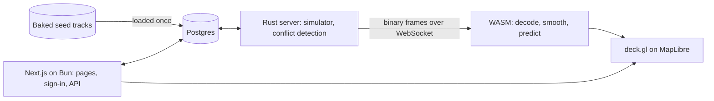

# atcdemo

A real-time air traffic picture of the Boston / New York / Philadelphia / DC corridor, built to stay at 60 fps from a few hundred aircraft up to 50,000+.

> **Status: milestone 1, scaffold.** The workspaces build and the page loads a WASM module, but there is no map yet. The full design is in [docs/DESIGN.md](docs/DESIGN.md).

## What it will do

- Show live-looking traffic on a MapLibre map, in 2D and 3D, by replaying recorded real ADS-B tracks.
- Predict each aircraft's path up to 20 minutes ahead, with a timeline to scrub through the predicted picture.
- Detect and flag predicted conflicts between en-route aircraft (pairs coming within 5 nm laterally and 1,000 ft vertically).
- Draw airspace: Class B shelves as 3D volumes, and ARTCC boundaries.
- Provide a sortable flight list, flight search and a detail panel synced with the map.
- Multiply traffic in a stress mode, with an on-screen readout of frame rate and decode time.
- Require sign-in.

The app is watch-only: aircraft always follow their recorded paths.

## How it is built

| Part | Technology |
|---|---|
| Real-time server | Rust (axum, tokio): a simulator that replays recorded tracks, conflict detection, and the WebSocket |
| Transport | WebSocket with binary frames, filtered to each client's viewport |
| Shared core | One Rust crate for the wire format, prediction and conflict maths, compiled natively for the server and to WASM for the browser |
| Web app and API | Next.js, React, TypeScript, Drizzle, Zustand, TanStack Query, Tailwind CSS, shadcn/ui, running on Bun |
| Map and rendering | MapLibre GL JS with deck.gl layers reading typed arrays straight from WASM memory |
| Auth | Better Auth, with a short-lived signed token the Rust server verifies |
| Database | Postgres for recorded tracks, accounts, saved views, preferences and alert history |



## Configuration

Every process reads its configuration from environment variables at run time. For a local run:

```bash
cp .env.example .env
```

That is enough: the defaults in [.env.example](.env.example) work as they stand, and the file describes each variable. `.env` is not committed.

- The web app's scripts (`dev`, `start`, `test`, `db:migrate`) read `.env` from the repo root. Variables already set in the environment win over the file.
- The web app and `atc-server` both check their configuration at startup. If a required variable is missing or malformed, the process stops and names it.
- GitHub sign-in is optional. Leave `GITHUB_CLIENT_ID` and `GITHUB_CLIENT_SECRET` empty and the app offers only the demo accounts. To turn it on, create an OAuth app at <https://github.com/settings/developers> with the callback URL `http://localhost:3000/api/auth/callback/github` and set both.
- The secret and the demo passwords in `.env.example` are public. Replace them anywhere but a local run.

## Running it (planned)

None of this works yet; it is the intended workflow once the scaffold lands.

```bash
# Backend and Postgres
docker compose up

# Web app, in a second terminal
bun install
bun dev
```

`docker compose --profile full up` will run the web app in a container too, so one command starts everything.

You will need Docker, [Bun](https://bun.com) 1.4.5 or newer, a Rust toolchain, and [`wasm-pack`](https://github.com/wasm-bindgen/wasm-pack) (`cargo install wasm-pack`). The production build of the web app crashes on Bun 1.3.8.

### The WASM package

The browser module is built from `crates/atc-wasm` into `packages/atc-wasm`, which is not committed.

| Command | What it does |
|---|---|
| `bun run wasm:build` | Builds the package once. `bun dev` and `bun run build` run this first |
| `bun run wasm:watch` | Builds, then rebuilds whenever `crates/atc-core` or `crates/atc-wasm` changes. Run it in a second terminal beside `bun dev`; `next dev` serves the rebuilt module on the next page load |

## Roadmap

1. Scaffold the Bun and cargo workspaces and the compose file.
2. Seed tool, simulator and WebSocket hub.
3. Map, WASM decode and smoothing, 2D aircraft layer, performance readout.
4. Sign-in, roles and token verification.
5. Flight list, detail panel, trails, saved views.
6. 3D mode and airspace overlays.
7. Prediction, time scrubber, conflict alerts.
8. Stress mode and a WASM versus JavaScript comparison.
9. Web app Dockerfile and the `full` compose profile.

## Licence

The code is under the [MIT licence](LICENSE). Data and assets come from other sources and keep their own terms, recorded in [data/README.md](data/README.md).
