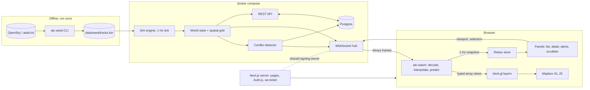
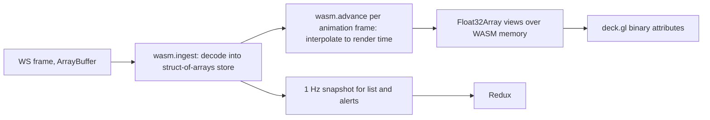
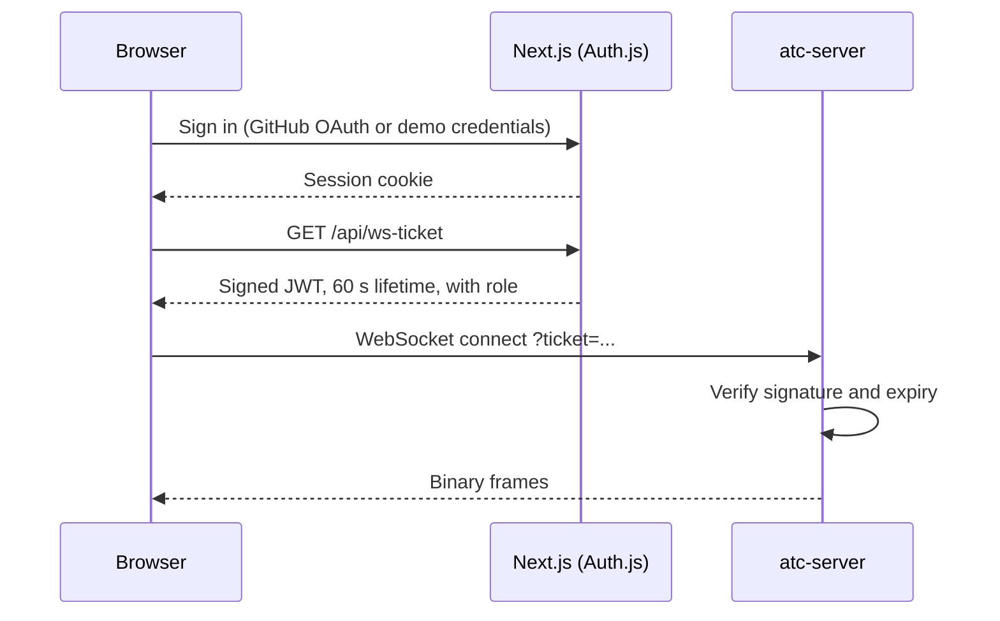

# ATC Demo: Design Document

Status: draft 3, 2026-11-24

## 1. Goals and non-goals

**Goals**

- A live traffic picture of the Boston / New York / Philadelphia / DC corridor that stays at 60 fps from a few hundred aircraft up to 50,000+.
- Go beyond a flight tracker with decision-support features: trajectory prediction with a time scrubber, conflict detection, and airspace overlays.
- 2D and 3D modes.
- Authenticated access.
- One command (`docker compose up`) starts the backend and Postgres with no external dependencies at runtime.
- Runs locally first, but stays deployable: all configuration comes from environment variables and the images are self-contained.

**Non-goals (v1)**

- Live ADS-B ingestion. The feed interface leaves room for it.
- Operational accuracy. Separation rules and prediction are simplified.
- Instructing aircraft. The app is watch-only: aircraft always follow their recorded paths.
- Mobile layout, multi-region scaling.
- A public deployment. It is a later step, not part of v1.

## 2. Decisions

| Area | Decision | Reason |
|---|---|---|
| Data | Simulator replaying recorded real tracks | Authentic callsigns and flight paths, deterministic, works offline |
| Seed source | OpenSky REST API, adsb.lol daily dumps as fallback | OpenSky's full history DB needs a research account |
| Backend | Rust (axum + tokio) | Shares a crate with the browser WASM module |
| Transport | WebSocket, binary frames server to client | Compact, viewport-filtered push; the client sends viewport changes back |
| Auth | Auth.js in Next.js, short-lived ticket for the socket | Self-contained, no paid service |
| Rendering | deck.gl interleaved with Mapbox GL JS | Picking, trails and 3D come built in; attributes come straight from WASM memory |
| Scale | 300-800 aircraft by default, stress multiplier to 50k+ | Realistic picture plus a provable performance story |
| UI state | Redux Toolkit, for UI state only | Per-frame position data never enters Redux |
| Map | Mapbox GL JS with an account token | Terrain and the standard style; the free tier is ample for a demo |
| JS tooling | Bun for installs, workspaces, scripts, tests and as the Next.js runtime | Fast installs and one tool in place of Node + pnpm |
| Web scaffold | `apps/web` starts from [bun-templates/bun-nextjs-basic](https://github.com/bun-templates/bun-nextjs-basic) | Next.js 16, React 19, TypeScript and Tailwind CSS 4, already wired to run on Bun |
| Styling and components | Tailwind CSS 4 + shadcn/ui | Ready-made accessible panels, tables, dialogs and inputs; setup copied from [bun-nextjs-todo](https://github.com/bun-templates/bun-nextjs-todo) |
| Web tooling | Biome for lint and format, Zod for validating REST payloads, React Compiler | Also taken from `bun-nextjs-todo` |
| Database | Postgres in compose, accessed from Rust with sqlx | Saved views, preferences and alert history; real models and CRUD endpoints |
| Interaction | Watch-only | Keeps the simulator a pure replay, so prediction error stays measurable |
| Hosting | Local now, deployable later | Config in env vars, self-contained images |
| Web app in dev | Bare metal with `bun dev`; a production Dockerfile behind a compose profile | Fast reload and a simple WASM rebuild loop day to day, one-command start when wanted |

## 3. Architecture



`atc-core` is the centre of the design: one Rust crate holding the wire format, kinematics, prediction and conflict maths. It compiles natively into the server and to WASM for the browser, so both sides encode, decode and predict with the same code.

## 4. Repository layout

```
atcdemo/
  Cargo.toml              # cargo workspace
  package.json            # Bun workspaces: apps/*, packages/*
  bun.lock
  docker-compose.yml      # atc-server + postgres; web behind the "full" profile
  crates/
    atc-core/             # wire format, kinematics, prediction, conflicts; no I/O
    atc-server/           # axum app: sim engine, WebSocket hub, REST
      migrations/         # sqlx migrations
    atc-wasm/             # wasm-bindgen wrapper around atc-core
    atc-seed/             # CLI that downloads and bakes seed tracks
  apps/
    web/                  # Next.js (App Router), TypeScript
  packages/
    atc-wasm/             # wasm-pack output, consumed by apps/web
  data/
    seed/                 # baked tracks, committed
    airspace/             # Class B/C and sector GeoJSON
  docs/DESIGN.md
```

**Running it.**

- `docker compose up` starts Postgres and `atc-server`. The web app runs alongside with `bun dev`, outside Docker, so hot reload and the WASM rebuild loop stay native.
- `docker compose --profile full up` also builds and runs the web app from `apps/web/Dockerfile`, for a hands-off demo or a deploy rehearsal. The Mapbox token is a public variable that Next.js bakes in at build time, so it is passed to that image as a build argument.

**Bun.** Bun replaces Node and pnpm: `bun install` for workspaces, `bun run` for scripts, `bun test` for unit tests, and `bun --bun next dev` to run Next.js on the Bun runtime. `apps/web` is scaffolded from the `bun-nextjs-basic` template, whose `dev`, `build` and `start` scripts already use `bun --bun next`; Redux Toolkit, Mapbox GL JS, deck.gl and Auth.js are added on top. The shadcn/ui, Biome, Zod and React Compiler setup is borrowed from the `bun-nextjs-todo` template. That template's database layer (Bun's SQL client called from Next.js server actions) is deliberately left out, because here the Rust server owns Postgres. Next.js is built for Node first, so if a Next.js or Auth.js feature misbehaves under the Bun runtime, the fallback is to keep Bun as the package manager and run Next.js on Node. Nothing else in the design depends on which runtime serves the web app.

## 5. Seed data and the simulator

**Baking (`atc-seed`, offline).** Pull a 4-6 hour window of flights inside the corridor bounding box (roughly 38°N to 43.5°N, 78°W to 69.5°W), fetch each flight's track, resample to a fixed interval, and write one compact binary file with per-flight metadata (ICAO24, callsign, type, origin, destination) and waypoints (time, lat, lon, altitude, ground speed, track, vertical rate). API limits and exact endpoints need checking when this is built; adsb.lol's daily dumps are the fallback.

**Replay.** The sim engine advances a clock at 1 Hz and interpolates each active flight along its recorded waypoints. When the window ends it loops.

**Stress mode.** A multiplier clones flights with a time offset, a small lateral offset and a synthetic ID. Multiplier 1 is the real picture; 100 gives 50k+ aircraft.

**Feed interface.** The engine sits behind a `Feed` trait so a live adapter can replace it later.

## 6. Wire protocol

Client to server messages are small JSON text frames: `hello`, `viewport {bbox, zoom}`, `select {id}`.

Server to client messages are little-endian binary frames:

| Field | Type | Notes |
|---|---|---|
| version | u8 | |
| kind | u8 | positions, metadata, removals, alerts |
| seq | u32 | gap detection |
| sim time | f64 | milliseconds |
| count | u32 | |
| records | count × fixed size | |

Position record, 20 bytes:

| Field | Type | Unit |
|---|---|---|
| id | u32 | ICAO24 or synthetic |
| lat, lon | i32 × 2 | 1e-7 degrees |
| altitude | u16 | 25 ft |
| ground speed | u16 | knots |
| track | u16 | 360/65536 degrees |
| vertical rate | i16 | ft/min |

At 20 bytes per aircraft an unfiltered 50k frame is 1 MB, so the hub filters each client's frame to its viewport plus a margin using the spatial grid. Callsign, type and route go in a separate metadata frame, sent once when an aircraft first enters a client's viewport.

**Slow clients.** Each connection gets a latest-wins slot, not a queue. A client that falls behind skips frames and never builds a backlog.

**REST.** `GET /healthz`, `GET /api/flights/:id` (metadata and track history), `POST /api/sim/config` (stress multiplier, role-gated), plus the persistence endpoints in section 11.

## 7. Client data path



- The WASM module owns the aircraft store. JavaScript never holds per-aircraft objects.
- Rendering runs about one update behind the newest frame and interpolates between the last two samples, so motion is smooth at a 1 Hz feed. If a frame is late it extrapolates by dead reckoning.
- deck.gl reads positions, headings and colours as typed-array views directly over WASM memory, so there is no per-frame copy or garbage. Views are recreated when WASM memory grows.
- WASM runs on the main thread in v1. Moving it to a worker needs SharedArrayBuffer and cross-origin isolation headers; do that only if profiling calls for it.
- A performance HUD shows fps, decode time, interpolate time, aircraft count and bytes per second. A toggle switches to a plain-JavaScript implementation of the same path for a side-by-side comparison.

## 8. Rendering and 3D

deck.gl's `MapboxOverlay` in interleaved mode, so layers depth-sort with the Mapbox scene.

| Layer | Purpose |
|---|---|
| IconLayer | Aircraft, rotated by track, coloured by altitude band |
| PathLayer | Trail for selected and hovered aircraft |
| LineLayer | Prediction vectors; conflict pair links |
| ScenegraphLayer | 3D aircraft models at close zoom in 3D mode |
| LineLayer (3D) | Stems dropping from each aircraft to the ground |
| Mapbox fill-extrusion | Airspace volumes with floor and ceiling |

3D mode pitches the camera, turns on Mapbox terrain, and places aircraft at altitude with an adjustable vertical exaggeration (the corridor is about 700 km long and cruise is about 11 km high, so true scale looks flat).

## 9. Decision-support features

**Trajectory prediction.** `atc-core` projects each aircraft forward from its current state only (position, track, speed, vertical rate, levelling off at a plausible cruise or field altitude). It runs in WASM so the scrubber is instant. Dragging the timeline up to 20 minutes ahead redraws the predicted picture.

Because the simulator replays recorded tracks, the true future is known. The detail panel can therefore show prediction error against what actually happened, which is an honest measure of the predictor.

**Conflict detection.** The server runs it every 5 seconds: a grid broad phase, then closest point of approach on predicted paths. Pairs predicted to come within 5 nm laterally and 1,000 ft vertically inside the look-ahead window produce an alert frame. The map links the pair and the alerts panel lists them by time to closest approach.

**Airspace overlays.** Class B shelves for BOS, NYC, PHL and DC, plus ARTCC sector boundaries, from FAA open data baked to GeoJSON.

**Flight list and detail.** A virtualised, sortable, filterable table synced with map selection. The detail card shows route, altitude profile and speed.

## 10. Authentication



Auth.js session cookies are encrypted and awkward to verify outside Next.js, and browsers cannot set headers on a WebSocket. So Next.js mints a short-lived ticket signed with a secret shared with the backend. Roles: `viewer`, and `controller`, which may change simulator settings.

## 11. Persistence

Postgres runs as a compose service. `atc-server` owns the schema through sqlx migrations applied at startup.

| Table | Contents |
|---|---|
| `users` | Subject from the auth ticket, display name, role; upserted on first connect |
| `saved_views` | Per-user named camera positions, 2D/3D mode, filters |
| `preferences` | Per-user units, vertical exaggeration, layer visibility |
| `alerts` | Conflict history: aircraft pair, predicted time and distance of closest approach, when raised and cleared |

Endpoints: CRUD on `/api/views`, `GET`/`PUT /api/preferences`, `GET /api/alerts` with time-range paging. The browser authenticates REST calls with the same short-lived ticket, sent as a bearer token and refreshed when it expires.

Auth.js keeps signed-cookie sessions and does not use the database, so the web app has no database connection of its own.

## 12. Milestones

1. Scaffold: Bun and cargo workspaces, compose file with Postgres, CI lint and test.
2. `atc-seed`, sim engine, WebSocket hub; verify with a CLI client.
3. Map, WASM decode and interpolation, 2D aircraft layer, performance HUD.
4. Auth, the socket ticket, and the `users` table.
5. Flight list, detail panel, trails, saved views and preferences.
6. 3D mode and airspace overlays.
7. Prediction, time scrubber, conflict alerts and alert history.
8. Stress mode and the WASM versus JavaScript comparison.
9. Web app Dockerfile and the `full` compose profile.

Performance targets, to be measured on an M-series laptop: 60 fps at 50,000 aircraft, under 2 ms to decode a frame, under 1 ms to interpolate.

## 13. Open questions

No design decisions are open. Two things need checking during the build:

1. **Seed download.** OpenSky's current REST endpoints and rate limits, with adsb.lol's daily dumps as the fallback (milestone 2).
2. **Auth.js on the Bun runtime.** If it misbehaves, run Next.js on Node and keep Bun as the package manager (milestone 4).

## 14. Possible later work

- What-if instructions: try a heading or altitude change on one aircraft and see the predicted picture and conflicts update, on the user's own screen only.
- Real instructions that change the shared simulation, which needs a flight model in the simulator.
- A live ADS-B feed adapter behind the `Feed` trait.
- A public deployment.
