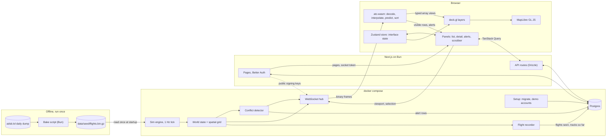
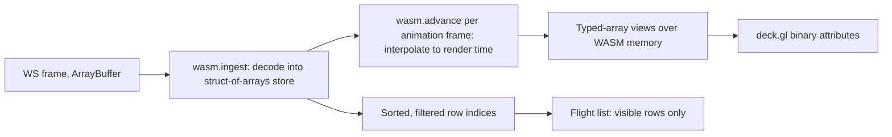
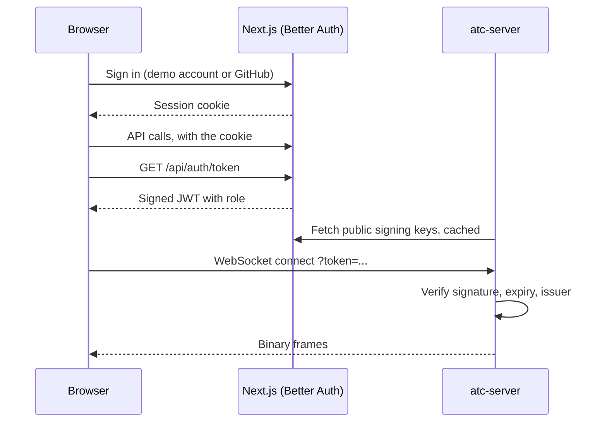

# ATC Demo: Design Document

Status: draft 5, 2026-11-25

## 1. Goals and non-goals

**Goals**

- A live traffic picture that stays at 60 fps from the real traffic of its coverage area up to 50,000+ aircraft. It covers the continental United States.
- Go beyond a flight tracker with decision-support features: trajectory prediction with a time scrubber, conflict detection, and airspace overlays.
- 2D and 3D modes.
- Authenticated access with two roles.
- One command (`docker compose up`) starts Postgres and the real-time server, replaying the recorded flights. The backend needs no external service at runtime. The browser still fetches map tiles from hosted services, and GitHub sign-in needs GitHub; the demo accounts do not. No account or token is needed to run it.
- Runs locally first, but stays deployable: all configuration comes from environment variables read at run time, and the images are self-contained.
- Only the simulator knows the recording. Everything else, the database and the browser included, sees a flight only as far as it has flown, as it would with a live feed.

**Non-goals (v1)**

- Live ADS-B ingestion. The feed interface leaves room for it.
- Operational accuracy. Separation rules and prediction are simplified.
- Instructing aircraft. The app is watch-only: aircraft always follow their recorded paths.
- Mobile layout, multi-region scaling.
- A public deployment. It is a later step, not part of v1.

## 2. Decisions

| Area | Decision | Reason |
|---|---|---|
| Data | Simulator replaying recorded real tracks | Authentic callsigns and flight paths, deterministic, works offline |
| Coverage | The continental United States: a box from 24.4°N to 49.4°N and 125°W to 66.9°W, over a 4 hour window | About 8,000 aircraft airborne at once, where the source's receivers are densest and where FAA airspace data applies. The download spike measured it against a north-eastern region and the whole sky; the numbers are in section 5 |
| Seed source | adsb.lol's daily archive, [`adsblol/globe_history`](https://github.com/adsblol/globe_history); recording OpenSky's live state vectors as the fallback | adsb.lol carries speed, track, vertical rate and aircraft type, needs no account, and is ODbL, so the baked data can be committed with attribution. OpenSky's track endpoint lacks speed and vertical rate and its redistribution terms are unconfirmed |
| Seed data | Tracks clipped to the coverage area, resampled to 10 s, committed as a gzip-compressed binary file under a 50 MB budget, and read by the simulator at startup | A fresh clone works offline. As CSV the chosen coverage is 130 MB; storing differences between samples brings it to about 41 MB. A `dump` command prints the file as text. The recording is the simulator's private input, so it is not loaded into Postgres |
| Flight history | `atc-server` writes each real flight to Postgres as it flies: one row when it appears, its track in batches | The database only ever holds the past, so the web API cannot give away the future, and nothing downstream of the simulator would change with a live feed |
| Real-time server | Rust (axum + tokio): simulator, conflict detector and the WebSocket, nothing else | The heavy, threaded work, and it shares a crate with the browser WASM module |
| API | Next.js route handlers on Bun: flight history, saved views, preferences, alert history | Ordinary database reads and writes in TypeScript, on the same origin as the pages, so the session cookie is enough |
| Transport | WebSocket, binary frames server to client | Compact, viewport-filtered push; the client sends viewport changes back |
| Auth | Better Auth in Next.js, database-backed, with its admin and JWT plugins | Actively developed successor to Auth.js. Roles, demo accounts and a token the Rust server can verify are all documented features |
| Rendering | deck.gl interleaved with MapLibre GL JS, through `@deck.gl/maplibre` | Picking, trails and 3D come built in; attributes come straight from WASM memory |
| Scale | The real traffic of the coverage area by default, stress multiplier to 50k+ | Realistic picture plus a provable performance story |
| Aircraft data in the browser | Held only in WASM memory | JavaScript never holds a per-aircraft object, at any scale |
| Interface state | Zustand | About a dozen fields; must be readable from the render loop and the socket client, outside React |
| Server data in the browser | TanStack Query | Caching and refetching for flight history, saved views, preferences and alert history |
| Map | MapLibre GL JS v6 | Open source, with terrain, sky and extrusions, and no account or token. Mapbox GL JS's licence requires an active Mapbox account |
| Map tiles | Hosted and free: OpenFreeMap vector tiles for the base map, Mapterhorn for terrain | Neither needs registration or a key. Serving tiles from local files is left for later |
| JS tooling | Bun for installs, workspaces, scripts, tests and as the Next.js runtime | Fast installs and one tool in place of Node + pnpm |
| Web scaffold | `apps/web` starts from [bun-templates/bun-nextjs-todo](https://github.com/bun-templates/bun-nextjs-todo) | Next.js 16, React 19, TypeScript, Tailwind CSS 4, shadcn/ui, Biome and Zod, already wired to run on Bun |
| Web settings | React Compiler on, `cacheComponents` off | The template installs the compiler plugin without enabling it, and turns `cacheComponents` on; this app is live data behind a sign-in with nothing worth caching |
| Database | One Postgres in compose, one schema, owned by Drizzle in the web app | One migration tool for the application tables and Better Auth's tables. The Rust server writes flight history and alert rows and reads nothing |
| Data layer | Drizzle with the `pg` driver | Typed queries and migrations; Better Auth has an adapter for it; `pg` also runs on Node |
| Offline tools | Bun scripts | Baking tracks and airspace is one-off file processing; it does not need Rust |
| Interaction | Watch-only | Keeps the simulator a pure replay, so the picture is repeatable from one pass to the next |
| Hosting | Local now, deployable later | Config in env vars, self-contained images |
| Web app in dev | Bare metal with `bun dev`; a production Dockerfile behind a compose profile | Fast reload and a simple WASM rebuild loop day to day, one-command start when wanted |

## 3. Architecture



Two servers, with a clear line between them:

- **`atc-server` (Rust)** is the real-time engine. It runs the simulator and the conflict detector, records what has flown, and speaks to browsers over one WebSocket. It has no REST API beyond a health check.
- **The Next.js app** is everything else: pages, sign-in, and the API for flight history, saved views, preferences and alert history.

`atc-core` is the centre of the Rust side: one crate holding the wire format, kinematics, prediction and conflict maths. It compiles natively into the server and to WASM for the browser, so both sides encode, decode and predict with the same code.

## 4. Repository layout

```
atcdemo/
  Cargo.toml              # cargo workspace
  package.json            # Bun workspaces: apps/*, packages/*, tools
  bun.lock
  docker-compose.yml      # postgres, setup, atc-server; web behind the "full" profile
  .env.example            # every variable in the table below
  LICENSE
  crates/
    atc-core/             # wire format, kinematics, prediction, conflicts; no I/O
    atc-server/           # sim engine, conflict detector, WebSocket hub
    atc-wasm/             # wasm-bindgen wrapper around atc-core
  apps/
    web/                  # Next.js (App Router), TypeScript
      app/api/            # route handlers: auth, flights, views, preferences, alerts
      db/                 # Drizzle schema, migrations, setup script
  packages/
    atc-wasm/             # wasm-pack output, not committed
  tools/                  # Bun scripts: bake tracks, bake airspace
  data/
    README.md             # sources, dates, licences and attribution
    seed/                 # baked flights, committed
    airspace/             # Class B and ARTCC boundary GeoJSON
  docs/DESIGN.md
```

**Running it.**

- `docker compose up` starts Postgres, runs a one-shot `setup` service, then starts `atc-server`. Setup applies the Drizzle migrations and creates the demo accounts. The `atc-server` image carries the seed file. The web app runs alongside with `bun dev`, outside Docker, so hot reload and the WASM rebuild loop stay native.
- `docker compose --profile full up` also builds and runs the web app from `apps/web/Dockerfile`, for a hands-off demo or a deploy rehearsal. That image needs a Rust and `wasm-pack` build stage and the repo root as its build context.

**Bun.** Bun replaces Node and pnpm: `bun install` for workspaces, `bun run` for scripts, `bun test` for unit tests, and `bun --bun next dev` to run Next.js on the Bun runtime. `apps/web` is scaffolded from the `bun-nextjs-todo` template, whose scripts already use `bun --bun next`. Its todo actions, components and compose file are deleted. Drizzle, Zustand, TanStack Query, TanStack Virtual, MapLibre GL JS, deck.gl and Better Auth are added on top.

The template reaches Postgres through Bun's built-in SQL client. This app uses Drizzle over the `pg` driver instead, which also runs on Node. Next.js is built for Node first, so if a Next.js or Better Auth feature misbehaves under the Bun runtime, the fallback is to keep Bun as the package manager and run Next.js on Node. Nothing else in the design depends on which runtime serves the web app. The milestone 1 spike found one such problem, with a one-line fix, so the app stays on Bun; see section 11.

**React Compiler.** Enabled in `next.config.ts`. The components that own the map and the deck.gl overlay mutate imperative objects, so they opt out with `"use no memo"`.

**WASM package.** `bun run wasm:build` runs `wasm-pack build crates/atc-wasm --target web --no-pack` and writes to `packages/atc-wasm`. The output is not committed, so a fresh clone, CI and the web image all build it, and each needs a Rust toolchain and `wasm-pack`. The root `dev` and `build` scripts run it first. `bun run wasm:watch` rebuilds on every change under `crates/atc-core` and `crates/atc-wasm`, and `next dev` serves the rebuilt module on the next page load.

The milestone 1 spike settled how the web app loads it (wasm-pack 0.15.1, wasm-bindgen 0.2.130, Next.js 16.3.1):

- **No `package.json` in the output.** `--no-pack` leaves it out, so `packages/atc-wasm` is not a workspace package. `bun install` and `bun.lock` therefore do not depend on whether the WASM has been built. The web app finds the module through a `paths` entry in its `tsconfig.json`, which maps `atc-wasm` to the generated `atc_wasm.js`; Turbopack follows it, and the generated `.d.ts` gives the types.
- **Client-only import, explicit `init()`.** A client component calls `await import("atc-wasm")` inside an effect and then awaits the module's default export. The generated code locates the `.wasm` file with `new URL("atc_wasm_bg.wasm", import.meta.url)`, which Turbopack treats as an asset: it is emitted with a hashed name and fetched by the browser. Nothing WASM-related runs during prerendering.
- **Zero-copy views work.** `init()` returns the module's `memory`. Rust hands out a pointer and a count, and JavaScript wraps them in a typed array over `memory.buffer` with no copy.
- **`turbopack.root` is set to the repo root** in `next.config.ts`. Next.js already infers that root from `bun.lock`, so the setting is a safeguard: it keeps resolution working if the lockfile detection ever changes.
- It works the same under `next dev` and in a production build, and needed no loader configuration and no experimental flags.

**Configuration.** Everything is an environment variable read at run time. No value is baked into an image: the socket URL is read by the Next.js server on each request and passed to the page. Names may change during the build; `.env.example` is the authority.

| Variable | Read by | Purpose |
|---|---|---|
| `DATABASE_URL` | atc-server, web, setup | The one Postgres database |
| `ATC_STRESS_MULTIPLIER` | atc-server | Clone multiplier at startup, default 1 |
| `ATC_SEED_FILE` | atc-server | Path to the seed file. Optional; defaults to `data/seed/flights.bin.gz` under the working directory, which is the copy inside the image |
| `ATC_ALLOWED_ORIGIN` | atc-server | The web app's origin; socket connections from anywhere else are refused |
| `ATC_JWKS_URL` | atc-server | Where to fetch Better Auth's public signing keys |
| `ATC_AUTH` | atc-server | `off` treats every connection as a fixed dev user; for tests, the CLI client and milestones 2-3 |
| `BETTER_AUTH_SECRET`, `BETTER_AUTH_URL` | web | Session signing and the app's public URL |
| `GITHUB_CLIENT_ID`, `GITHUB_CLIENT_SECRET` | web | Optional. GitHub sign-in is offered only when both are set |
| `CONTROLLER_GITHUB_USERS` | web | GitHub usernames that become `controller` when their account is created |
| `DEMO_VIEWER_PASSWORD`, `DEMO_CONTROLLER_PASSWORD` | setup | Passwords for the two demo accounts |
| `ATC_WS_URL` | web | Where the browser reaches `atc-server` |

## 5. Seed data and the simulator

**Baking (a Bun script in `tools/`, offline).** Download one day of adsb.lol's world dump, keep the aircraft that are inside the coverage area during the 4 hour window, split each aircraft's trace into flights, clip each flight to the coverage area plus a margin of about half a degree, and resample to a fixed 10 s interval. Write `data/seed/flights.bin.gz`. The dump has no origin or destination, so those are left empty in v1. Aircraft without an ICAO24 address are left out.

**The seed file** is one gzip stream. Inside it everything is little-endian. The bake tool has a `dump` command that prints a file's flights, or one flight's samples, as text, since the file cannot be read by eye. `tools/seed/format.ts` is the reference for the layout.

The header is 20 bytes:

| Offset | Field | Type | Notes |
|---|---|---|---|
| 0 | magic | 4 bytes | `ATCS` |
| 4 | version | u8 | 1. A reader refuses a version it does not know |
| 5 | spacing | u8 | seconds between samples |
| 6 | reserved | u16 | 0 |
| 8 | window start | u32 | Unix time, seconds |
| 12 | window length | u32 | seconds |
| 16 | flight count | u32 | |

Then one 32-byte record per flight. A flight's position in this list is its flight id.

| Offset | Field | Type | Notes |
|---|---|---|---|
| 0 | ICAO24 | u32 | |
| 4 | callsign | 8 bytes | space-padded ASCII, as are the next three |
| 12 | type | 4 bytes | |
| 16 | origin | 4 bytes | |
| 20 | destination | 4 bytes | |
| 24 | first sample | u32 | index on the window's grid: sample n was taken (first sample + n) × spacing seconds into the window |
| 28 | sample count | u32 | |

Then seven columns, each a u32 byte length followed by that many bytes. A column holds every flight's samples in turn, in flight order.

| Column | Unit | Stored as |
|---|---|---|
| lat | 1e-5 degrees | second differences |
| lon | 1e-5 degrees | second differences |
| altitude | 25 ft above mean sea level | differences |
| ground speed | knots | differences |
| track | whole degrees, 0 to 359 | differences, taken the short way round, so -180 to 179 |
| vertical rate | 64 ft/min | differences |
| on ground | one bit per sample | bytes, lowest bit first, each flight starting on a new byte |

- The first six columns are signed variable-length integers: zigzag, so small negative numbers stay small, then seven bits to a byte with the low bits first and the top bit set on every byte but the last.
- "Differences" means a flight's first value is stored whole and each later one as the change from the one before.
- "Second differences" means the first value whole, the second as the change, and each later one as the change in the change. An aircraft flying straight at a steady speed becomes a run of zeros. Decoding adds the numbers back up and is exact.
- No sample is later than the window's length. A flight's last sample may sit exactly on it.

**The bake's rules.**

- Aircraft with no ICAO24 address are left out; adsb.lol names their files with a leading `~`.
- Altitude is height above mean sea level. A trace gives a barometric altitude, which is what the altimeter reads at standard pressure, and a geometric one, which is GPS height above the WGS84 ellipsoid. On the day baked the barometric reading was 200 to 300 ft low along the east coast: aircraft touched down at Teterboro reading -300 ft. The bake takes the geometric altitude and subtracts the height of the EGM96 geoid at that point, from a half-degree grid in `tools/seed/geoid-grid.json`. The 1% of points with only a barometric altitude take it plus the difference between the two at the nearest point in time that has both.
- Checked against published field elevations at 16 airports, the median altitude of aircraft on the ground is within 31 ft at 14 of them. Denver reads 84 ft low, on a field that slopes by more than that, and Miami 191 ft high on few samples.
- Vertical rate is the rate the aircraft reported, which is barometric for most.
- A trace point takes its speed, track, vertical rate and altitude from the last point that had them. A reported speed over 1,000 knots or vertical rate over 20,000 ft/min is treated as missing.
- readsb reports no altitude on the ground. An on-ground point takes the altitude of the airborne point nearest to it in time within its flight: the last before a landing, the first after a take-off. That is roughly the field's elevation, so the altitude has no cliff at an inland airport.
- A flight's callsign is the last one reported during that flight. One that reports none has none; the callsign before it belongs to another flight.
- An aircraft's day is split into flights where readsb marks a new leg and where the trace is silent for more than 10 minutes.
- A position the aircraft could not have reached at 900 knots is left out if the trace comes back within the next three points. If it does not, a new flight starts there.
- Each flight is interpolated onto the window's 10 s grid, then clipped. Each unbroken stretch inside the box plus half a degree is a flight of its own, so one that leaves and returns is two. A stretch that only touches the margin is dropped.
- A clipped flight under a minute long, or one that never leaves the ground, is dropped.
- Flights are ordered by first sample, then ICAO24, so the same dump always gives the same file.

**The file as baked.** 39,716 flights and 12.6 million samples in 40.6 MB. Between 7,415 and 8,324 aircraft are airborne at any moment, 7,978 on average; 478 flights have no callsign and 2,143 no type. The bake takes 75 s in 8 processes.

The script fails if the output exceeds 50 MB. If the real file is too large, shorten the window.

**What the spike measured.** The day is 2026-11-20, a Friday, from `readsb-prod-0`. The measuring scripts were in `tools/spike/` until the bake script replaced them.

| Measure | Result |
|---|---|
| Download | 3.8 GB (3.5 GiB) in two parts; 28 minutes at about 2 MB/s |
| Unpacked | 2.8 GB of traces in 74,764 files, one per aircraft, and 0.85 GB of heatmap; 65 s to unpack |
| As JSON | 18.4 GB and 104 million points for the day |
| One pass over every trace | 2.5 minutes with Bun in 8 processes on an M-series laptop |
| Time between points | Median 4 s, 90th percentile 20 s, so a 10 s grid invents little |
| Position source | 94% ADS-B, 3% ADS-R, under 1% MLAT |
| Missing fields | Callsign on 1-4% of flights, aircraft type on 5-8% |
| Addresses that are not ICAO24 | 8,463 files, named with a leading `~`: TIS-B and other targets with no airframe identity |

The three candidate coverages, over windows starting at 17:00 UTC, which is noon on the US east coast. The file sizes are of real files in the first format considered, a gzipped CSV at 10 s spacing.

| | North-east US | Continental US | Whole sky |
|---|---|---|---|
| Box | 38°N to 43.5°N, 78°W to 69.5°W | 24.4°N to 49.4°N, 125°W to 66.9°W | none |
| Flights in 4 / 5 / 6 h | 7,074 / 8,377 / 9,383 | 41,708 / 49,988 / 56,480 | 62,039 / 73,861 / 83,689 |
| Peak airborne | 1,069 | 8,379 | 11,825 |
| Mean airborne over 5 h | 938 | 7,992 | 11,414 |
| CSV in 4 / 5 / 6 h | 16 / 20 / 23 MB | 130 / 162 / 192 MB | 189 / 234 / 275 MB |

- Flights are counted after clipping, so a flight that leaves the area and returns counts twice. A flight that never leaves the ground, or lasts under a minute, is not counted.
- adsb.lol's receivers are concentrated in North America and Europe. The whole sky holds only 40% more aircraft than the continental US box, so elsewhere the picture would be patchy.
- Only the north-east fits 50 MB as CSV. What decides the size is the encoding more than the container. For the continental US:

| Format, gzipped | 2 h | 3 h | 4 h | 5 h |
|---|---|---|---|---|
| CSV | 64 MB | 97 MB | 130 MB | 162 MB |
| CSV at 20 s spacing | 35 MB | 53 MB | 72 MB | 89 MB |
| Binary, fixed-width fields | 50 MB | 76 MB | 102 MB | 127 MB |
| Binary, each value as the difference from the last | 26 MB | 39 MB | 53 MB | 65 MB |
| The same, with positions as second differences | 20 MB | 30 MB | 41 MB | 50 MB |

- zstd in place of gzip saves a further 6%, which does not earn a new dependency on both sides.

**The choice.** The continental United States, a 4 hour window from 17:00 to 21:00 UTC, 10 s spacing, in the last format of the table, committed to the repository at about 41 MB. The spike counted 41,708 flights, with about 8,000 airborne at any moment, so multiplier 7 gives 50,000+. The bake's own rules give slightly fewer; its figures are above. The simulator holds the recording in memory as fixed-width samples, about 200 MB.

**The source archive.** adsb.lol publishes its history at [`adsblol/globe_history`](https://github.com/adsblol/globe_history), described in its [historical data documentation](https://www.adsb.lol/docs/open-data/historical). At the time of writing that link serves the 2026 archive, `globe_history_2026`.

- One GitHub release holds one day of the whole sky. There is one release per server instance (`readsb-prod-0`, `readsb-prod-1`, `readsb-staging-0`); use prod, and staging for a day when prod looks short.
- A day is a tar archive split into parts, for example `v2025.05.18-planes-readsb-prod-0.tar.aa` and `.tar.ab`. Join the parts before unpacking.
- Inside, `traces/` has one gzip-compressed JSON file per aircraft per day, written by readsb, and `heatmap/` has the point cloud behind adsb.lol's own replay. The trace fields are documented in [readsb's README-json](https://github.com/wiedehopf/readsb/blob/dev/README-json.md#trace-jsons).
- It is a download only. There is no query API, no filter by region and no per-flight access, so the bake script filters a whole day itself.
- The licence is ODbL 1.0.
- The archive also holds `acas/`, `LICENSE-ODbL.txt`, `LICENSE-cc0.txt` and a `README.txt` naming the day and the release.

**Loading.** `atc-server` reads the seed file once at startup and runs from memory after that. The file is copied into the server's image, and `ATC_SEED_FILE` can point at another one. If the file is missing, cannot be decoded, is of a format version the server does not know, or holds no flights, the server stops with a message naming the file and the reason. Reading the committed file takes about half a second and the server then holds about 200 MB. The recording is not loaded into Postgres, and no other part of the system reads it.

**Recording what has flown.** As the simulator runs, `atc-server` writes each real flight to Postgres, so the database holds what has happened and nothing else.

- When an aircraft first appears, the server inserts a `flights` row with its identity and the time. When it leaves, or the pass ends, the server sets the end time.
- Every 60 seconds the server appends, for each aircraft in the air, the 10 s samples it has flown since the last write, as one `flight_tracks` row. The writes run off the simulation loop, in one batch.
- Stress-mode clones are not recorded, so the write load does not grow with the multiplier. It is set by the real picture: with about 8,000 aircraft airborne that is about 8,000 `flight_tracks` rows a minute and 11.5 million a day. As array columns that is an estimated 3 to 5 GB a day, around 10 GB or more at the three-day retention, which is too much for a database started by `docker compose up` on a laptop. How the recorder stores tracks at this scale is open question 8.
- Rows older than three days are deleted, as for alerts, because every pass flies the same flights again.
- Rows left open by an earlier run are closed at startup.
- If the database is unreachable the simulator carries on. Samples wait in memory, up to a limit, and are written when it comes back; past the limit the oldest are dropped and the gap is logged.

The 1 Hz positions on the socket are not written anywhere.

**Fixture.** Rust tests and early milestone 2 work use a small generated set of a few dozen synthetic flights, so they need neither the download nor a database.

**Replay.** The sim engine advances a clock at 1 Hz and interpolates each active flight along its recorded waypoints.

- Sim time only moves forward for as long as the server runs. The position in the recording is sim time modulo the window length.
- The engine ticks once a second. A tick that would start late is skipped, not run in a burst afterwards, so under load sim time runs a little slow and clients never get a batch of stale frames.
- Each trip through the recording is a pass. A flight coming round again is a new aircraft with a new id, so trails, selection and alerts never carry over from one pass to the next.
- Flights cut by the window edges appear and vanish mid-air at the start and end of the recording. That is accepted.
- A flight that crosses the edge of the coverage area appears or disappears there, as it would at the edge of a facility's coverage.
- At multiplier 1 the whole picture empties and refills when the window ends. The server marks the first frame of a new pass and the client shows a brief "replay restarted" notice.

**Stress mode.** A multiplier clones flights with a time shift, a small sideways offset and the synthetic flag set. Time shifts are spread across the whole window, so clones wrap at different moments and the picture never visibly restarts at high multipliers. Multiplier 1 is the real picture; multiplier 7 gives 50k+ aircraft airborne. The multiplier is set at startup from `ATC_STRESS_MULTIPLIER` from milestone 2, so every later milestone can be run at 50k as it is built. Changing it at run time comes in milestone 8.

**Feed interface.** The engine sits behind a `Feed` trait so a live adapter can replace it later.

## 6. Wire protocol

`atc-server` exposes one WebSocket and `GET /healthz`. Everything else the browser needs comes from the Next.js API in section 7.

**Client to server** messages are small JSON text frames:

- `hello {protocol}`: the protocol version the client speaks. The server closes the socket with a distinct code on a mismatch.
- `viewport {bbox, zoom}`: sent, debounced, whenever the map moves.
- `select {id}`: the selected aircraft, or null. A selected aircraft keeps streaming after it leaves the viewport.
- `track {id}`: asks for the track an aircraft has flown so far. Sent when an aircraft is selected, and when one has been hovered for a moment.
- `set_multiplier {value}`: changes the stress multiplier. Refused unless the connection's role is `controller`.

**Server to client** traffic is binary. The server also sends two small JSON text messages: `sim {multiplier, windowSeconds}` on connect and whenever the multiplier changes, and `error {code, message}` when it refuses a request.

Binary frames are little-endian with a 24-byte header. Every field sits on its natural alignment, so the client can read frames through typed-array views.

| Offset | Field | Type | Notes |
|---|---|---|---|
| 0 | version | u8 | |
| 1 | kind | u8 | 1 positions, 2 metadata, 3 alerts, 4 track |
| 2 | record size | u16 | bytes per record; lets a client skip fields it does not know |
| 4 | seq | u32 | per connection |
| 8 | sim time | f64 | milliseconds, never decreases |
| 16 | count | u32 | |
| 20 | flags | u32 | bit 0: first frame of a new pass |
| 24 | records | count × record size | |

Position record, 20 bytes:

| Offset | Field | Type | Unit |
|---|---|---|---|
| 0 | id | u32 | aircraft id |
| 4 | lat, lon | i32 × 2 | 1e-7 degrees |
| 12 | altitude | i16 | 25 ft above mean sea level; signed, since some airports are below it |
| 14 | ground speed | u16 | knots |
| 16 | track | u16 | 360/65536 degrees |
| 18 | vertical rate | i8 | 64 ft/min, the resolution ADS-B itself reports; clamped to ±8,128 |
| 19 | flags | u8 | bit 0 on ground, bit 1 synthetic |

Every altitude on the socket is above mean sea level, not barometric, so an aircraft cruising at flight level 350 shows as its true height, which is rarely a round number. That is the price of aircraft landing on the runway and sitting correctly in the airspace volumes in 3D. Carrying both altitudes would need a wider record and is left for later.

Metadata record, 40 bytes: aircraft id (u32), flight id (u32), ICAO24 (u32), time shift in seconds (u32), sideways offset east and north in metres (i16 × 2), then space-padded ASCII for callsign (8), type (4), origin (4) and destination (4).

Alert record, 36 bytes: both aircraft ids (u32 × 2), both positions (i32 × 4), both altitudes (i16 × 2), seconds to closest approach (u16), predicted lateral distance in 0.01 nm (u16), predicted vertical separation in 25 ft (u16), flags (u16).

Track record, 24 bytes: aircraft id (u32), the sample's sim time in seconds (u32), then the position record's fields from lat and lon onwards. A track frame holds one aircraft's samples at 10 s spacing from the moment it appeared up to now, oldest first, and never a sample from the future.

**Two kinds of id.**

- The **flight id** is the flight's number in the seed file: one recorded flight. Only the simulator can turn it into a track. The browser uses it to tell which clones share a source, and the conflict detector uses it to skip them.
- The **aircraft id** is allocated by the simulator for one flight, one clone and one pass, and is unique for the life of the server process. Position and alert records use it.
- A row in the `flights` table has its own id and stores the aircraft id. The web API is keyed by the row id.
- The metadata record links the first two. It also carries the aircraft's time shift and sideways offset, which describe how a clone differs from its source.
- ICAO24 identifies an airframe, which can fly several legs in the window, so it is descriptive data and not a key.

**Frames are snapshots, so a skipped frame loses nothing.**

- A positions frame lists every aircraft in the client's viewport plus a margin, found through the spatial grid, plus the selected aircraft. The client drops any aircraft absent from the newest frame; there is no removals message.
- An alerts frame lists every active alert with either aircraft in the viewport. It carries both positions, so the link can be drawn when one end is off screen. It is capped at 500 records, soonest closest approach first.
- A metadata frame lists aircraft the client has not yet been told about. An aircraft counts as told only once its frame has been written to the socket, so a frame that is replaced before sending leaves its aircraft pending for the next one.
- A track frame answers one `track` request. It is built from the simulator's memory, so it works the same for a real aircraft and a clone, and it is complete from the first minute after startup. If the frame is replaced before it is sent, the request is answered again in the next one.
- A gap in `seq` therefore needs no resync. The client counts gaps for the performance HUD.

**Frame size.** At 20 bytes per aircraft a whole-picture frame at 50k is 1 MB per second. That is accepted in v1; there is no zoom-based thinning. Viewport filtering helps only when zoomed in.

**Slow clients.** Each connection gets a latest-wins slot, not a queue. A client that falls behind skips frames and never builds a backlog.

## 7. Web API

Next.js route handlers, on the same origin as the pages. Every route requires a signed-in session, read from the cookie; there are no bearer tokens and no cross-origin rules. Inputs are validated with Zod, queries go through Drizzle, and the browser calls them through TanStack Query.

| Route | Purpose |
|---|---|
| `/api/auth/*` | Better Auth: sign-in, sign-out, session, the socket token and the public signing keys |
| `GET /api/flights?search=` | Find flights by callsign among those flying now and those seen in the last three days |
| `GET /api/flights/:id` | One flight's details and its track as far as it has been recorded |
| `GET`, `POST /api/views`; `PUT`, `DELETE /api/views/:id` | Saved views, visible only to their owner |
| `GET`, `PUT /api/preferences` | The signed-in user's preferences |
| `GET /api/alerts` | Alert history, paged by wall-clock time |

**Tracks and "now".** The web API reads only what `atc-server` has written, so it can return nothing from the future. `GET /api/flights/:id` returns a finished flight's whole track, and a current flight's track up to the last batch, which is at most a minute old. It also returns the aircraft id and whether the flight is still in the air, so the browser can select it on the map.

The trail of an aircraft on the map does not come from here. It comes over the socket in a track frame, which is current to the second and also covers clones, and the browser then extends it from each new positions frame. The web API serves flights found by search and flights named in the alert history.

## 8. Client data path



- **The WASM store** is a block of memory inside the browser tab, owned by the Rust code. It holds the last two samples of each aircraft the server has sent this client, plus its metadata. It is rebuilt from the socket on every page load and is a few megabytes at 50k.
- The store also holds the track of the selected aircraft and of the hovered one, from their track frames, and appends a sample every 10 seconds from the positions frames.
- JavaScript never holds per-aircraft objects. The flight list asks WASM for the rows on screen (about 30), WASM does the sorting and filtering and returns row indices, and callsigns become JavaScript strings only for visible rows. A counter bumped once a second tells React to re-read, through `useSyncExternalStore`.
- **Interface state** lives in a Zustand store: selected and hovered aircraft, filters and sort order, 2D or 3D, vertical exaggeration, layer toggles, scrubber position, connection status, performance readings, and the current alerts (bounded by the 500-record cap). The render loop and the socket client read it directly.
- **Server data** (flight history, saved views, preferences, alert history) goes through TanStack Query to the web API.
- Rendering runs about one update behind the newest frame and interpolates between the last two samples, so motion is smooth at a 1 Hz feed. If a frame is late it extrapolates by dead reckoning. When a hidden tab becomes visible again it snaps to the newest frame.
- **Socket client.** Fetches a token, connects, sends `hello` and viewport changes, hands frames to `wasm.ingest`, and reconnects with backoff. Each reconnect fetches a fresh token; if the session has ended it redirects to sign-in.
- deck.gl reads its attributes as typed-array views directly over WASM memory. There is no per-frame JavaScript allocation and no garbage; deck.gl still uploads the buffers to the GPU once per frame, about 1 MB at 50k.

| Attribute | Layout | Notes |
|---|---|---|
| position | f32 × 3 | lon, lat, altitude. Float32 resolves to under a metre at this longitude, which is enough for icons |
| angle | f32 | degrees counter-clockwise, so the negative of track |
| colour | u8 × 4 | altitude band |
| icon | none | one icon for every aircraft in v1, so no per-aircraft accessor runs |

- Views are checked every frame and recreated when WASM memory grows, because a detached view reports length zero without raising an error.
- Picking returns a row index, which WASM maps to an aircraft id. Selection is always by id.
- WASM runs on the main thread in v1. Moving it to a worker needs SharedArrayBuffer and cross-origin isolation headers; do that only if profiling calls for it.
- A performance HUD shows fps, frame-time percentiles, WASM advance time, attribute update time, aircraft count, bytes per second and skipped frames. A toggle switches to a plain-JavaScript implementation of the same path for a side-by-side comparison.

## 9. Rendering and 3D

deck.gl's `MapLibreOverlay` in interleaved mode on MapLibre GL JS v6, so layers depth-sort with the map's own scene. Interleaving needs WebGL2. The base map is an OpenFreeMap vector style; terrain comes from Mapterhorn's elevation tiles.

| Layer | Purpose |
|---|---|
| IconLayer | Aircraft, rotated by track, coloured by altitude band |
| PathLayer | Trail for selected and hovered aircraft |
| LineLayer | Prediction vectors; conflict pair links |
| ScenegraphLayer | 3D aircraft models at close zoom in 3D mode |
| LineLayer (3D) | Stems dropping from each aircraft |
| Extruded polygons | Class B shelves with floor and ceiling |
| MapLibre line layer | ARTCC boundaries |

Rules that follow from how deck.gl and MapLibre interact:

- The map stays on the mercator projection. deck.gl's support for MapLibre's globe is experimental and does not draw flat icons.
- deck.gl layers are placed in the map's layer stack with the `beforeId` property.
- The map is created with antialiasing on; MapLibre turns it off by default, and path and line layers look jagged in interleaved mode without it.
- deck.gl layers are not draped over terrain: data at height zero renders at sea level. Stems therefore end at sea level and disappear into high ground. That is accepted.
- Vertical exaggeration is one value in the interface store. Terrain, aircraft height and airspace floors and ceilings all read it, so they stay in step.

3D mode pitches the camera, turns on terrain and sky, and places aircraft at altitude with an adjustable vertical exaggeration. Altitude is in feet above mean sea level, the same reference as the terrain and the airspace floors and ceilings, so the browser only converts feet to metres (the picture is about 4,500 km across and cruise is about 11 km high, so true scale looks flat).

## 10. Decision-support features

**Trajectory prediction.** `atc-core` projects each aircraft forward from its current state only (position, track, speed, vertical rate, levelling off at a plausible cruise or field altitude). It runs in WASM so the scrubber is instant.

**Prediction error.** Nothing outside the simulator knows the future, so the predictor is checked against the past, as it would be on a live feed. For the selected aircraft, WASM takes the sample from 1, 2 and 5 minutes ago in its track, predicts forward from that sample alone, and compares the result with where the aircraft is now. The detail panel shows the three errors. An aircraft that has been in the picture for less than a minute shows none yet.

**Time scrubber.** Dragging the timeline shows the predicted picture up to 20 minutes ahead.

- Prediction is taken from the moment scrubbing starts and is not re-anchored as new frames arrive, so the predicted picture does not jitter.
- Live aircraft are hidden. The list and the detail panel show predicted values.
- Conflict links are drawn between the predicted positions at the scrubbed time.
- A banner states that the picture is a prediction, and a "Return to live" button leaves the mode.

**Conflict detection.** The server runs it every 5 seconds on a snapshot of world state, off the main loop: a grid broad phase banded by altitude, then closest point of approach on predicted paths. Pairs predicted to come within 5 nm laterally and 1,000 ft vertically inside a 5-minute look-ahead produce an alert.

- En-route traffic only. Aircraft on the ground or below 10,000 ft are skipped, which removes taxiing aircraft and parallel approaches.
- Pairs cloned from the same recorded flight are skipped; they fly in trail by construction.
- An alert is keyed by its ordered pair of aircraft ids. It is raised on first detection, updated on each pass of the detector, and cleared after two passes without detection.
- Alerts involving a synthetic aircraft are shown but not saved.
- Open alerts are closed when a replay pass ends and when the server starts.

The map links the pair and the alerts panel lists them by time to closest approach.

**Airspace overlays.** Class B shelves inside the coverage area as extruded volumes, and the boundaries of its ARTCCs as lines, from FAA open data baked to GeoJSON by a Bun script. FAA data covers the United States only, so any coverage beyond it has no airspace layer. Class C is left out. Sector boundaries inside each ARTCC are left out too: the spike found no open source for them.

The airspace spike (issue #23) read the source on 2026-11-25, in the cycle effective 2026-10-29 to 2026-12-24. What it found:

- **Source.** The FAA's Aeronautical Data Delivery Service (ADDS), an ArcGIS open-data site at `adds-faa.opendata.arcgis.com`, published by Aeronautical Information Services. Two of its datasets are used, each one polygon layer that can be queried over HTTP with no key and returns GeoJSON:
  - Class B: `https://services6.arcgis.com/ssFJjBXIUyZDrSYZ/arcgis/rest/services/Class_Airspace/FeatureServer/0` (ADDS title "Class_Airspace").
  - ARTCC: `https://services6.arcgis.com/ssFJjBXIUyZDrSYZ/arcgis/rest/services/Boundary_Airspace/FeatureServer/0` (ADDS title "Airspace_Boundary").
  - Both descriptions say the data is published every eight weeks, the 56 day charting cycle, and give the effective dates. The ADDS data dictionary says the next cycle is posted about 20 days early in the `Pending_Class_Airspace` and `Pending_Boundary_Airspace` services. A query returns at most 2,000 rows; the two queries below return 359 and 41, so neither needs paging.
  - The 28 day NASR subscription on faa.gov carries the same two things in other forms: a Class B, C, D and E shapefile (a 150 MB zip), and the ARTCC boundaries as lists of points (`ARB`). Its README says the ARTCC file changes only on the 56 day cycle. The ArcGIS services are used because they return GeoJSON for a chosen area.
- **Class B rows.** One row is one polygon with one floor and one ceiling. The filter is `LOCAL_TYPE = 'CLASS_B'`, not `CLASS = 'B'`: the second also returns 53 rows that are not United States Class B areas, mostly Canadian control areas. `NAME` is the area ("BOSTON CLASS B"), `IDENT` its main airport ("BOS") and `SECTOR` the shelf ("AREA A"). A shelf can be more than one row with the same `NAME` and `SECTOR`, so the pair is not a key; `GLOBAL_ID` is.
- **Floor and ceiling.** `LOWER_VAL` and `UPPER_VAL` are numbers, `LOWER_UOM` and `UPPER_UOM` the unit, `LOWER_CODE` and `UPPER_CODE` the reference. In all 369 Class B rows:
  - The unit is `FT` at both ends. No Class B row uses flight levels (`FL` with code `STD`); other rows in the layer do.
  - Every ceiling is feet above mean sea level (`MSL`), from 1,000 to 12,500.
  - A floor is either the surface, written as `LOWER_VAL` 0 with `LOWER_CODE` `SFC` (40 rows), or feet `MSL` from 300 to 11,000 (329 rows). There is no `AGL` code in the layer. Height above ground is written as a non-zero value with code `SFC`. Nearly all the rows that have it are Class E, and none of the 369 does.
  - `UPPER_DESC` is `TI` (to and including) on every row. `LOWER_DESC` is null, or `ANI` (above but not including) on 10 rows. The bake script can ignore both.
  - No value is missing and every floor is below its ceiling. The sentinel for "not given" is -9998 with a null unit and code. It appears on other rows of the layer (Class E ceilings marked `AA`, and above) and on every ARTCC row, but on no Class B row. The bake script should still reject -9998 and null.
  - Four rows of San Diego have `EXCLUSION` 1 and `SECTOR` "VFR CORRIDOR EXCLUSION". The data dictionary says only that the polygon "is an exclusion area". Whether to draw them is left to the bake script's issue, which should check them against the chart.
- **Count.** The United States has 30 Class B areas in 369 rows. 29 areas in 359 rows lie inside the coverage box; the one outside is Honolulu. The areas range from 4 rows (Boston, Kansas City) to 28 (San Diego). An area is named for its city, so New York covers JFK, LaGuardia and Newark, "WASHINGTON-TRI AREA" covers the three Washington airports, and "COVINGTON" is Cincinnati.
- **Size.** Arcs are stored as many short segments. The 359 rows have about 249,000 vertices and make 6 MB of GeoJSON with coordinates rounded to six decimal places, 9.5 MB as served. The bake script will have to thin the arcs or round further before the file goes to a browser.
- **ARTCC rows.** `TYPE_CODE = 'ARTCC'` gives 43 rows for 21 centres, named by `IDENT` ("ZBW") and `NAME`. Each centre has a high-altitude boundary (`LOCAL_TYPE` `ARTCC_H`) and a low one (`ARTCC_L`). New York's high boundary is two rows. The altitude fields are all -9998 and `SECTOR` is null. The 20 centres of the contiguous United States intersect the coverage box, in 41 rows; Anchorage is the one that does not.
  - High and low boundaries are the same shape for 4 of the 20 (ZAB, ZLA, ZLC, ZOA) and differ for the rest, by a point or two in some and by a visible area in others, such as ZTL, ZME, ZNY and ZJX.
  - The bake script keeps both sets, marked high or low. The map draws the high set, since the conflict detector and most of the traffic are en route.
  - Oceanic airspace is not in these rows. The New York, Miami, Houston and Oakland oceanic control areas and flight information regions are separate rows (`TYPE_CODE` `CTA` and `FIR`), as are Honolulu, Guam and San Juan, and all are left out. The ARTCC polygons themselves run past the coast and past the edge of the box. They are not clipped.
- **Sectors.** Not published as open data, as far as the spike could find. What was checked:
  - The `Boundary_Airspace` layer: no ARTCC row has a `SECTOR`. The field is filled only for other kinds of airspace, such as the shelves of a terminal radar service area, and for parts of foreign control areas (Mexico, Cuba, the Bahamas, Canada and others).
  - The ADDS catalogue: all 73 items were listed and none is a sector dataset.
  - The NASR subscription for 2026-10-29: its file list, its README, and the layouts of the ARTCC boundary and ARTCC facility files. The boundary file has high, low and unlimited boundaries per centre and nothing finer.
  - The FAA's other aeronautical data pages: "Center Surface Boundaries" is one ground-level boundary per centre, and "ATCAA Boundaries" is a different kind of airspace.
  - SWIM: the flight data service (SFDPS) lists an "En Route Airspace Data" service that goes to "authorized consumers" over a SWIM subscription. That is not an open download. Whether it carries sector shapes could not be confirmed; its technical documents were not read.
- **Terms.** Both datasets carry the same licence text, which begins "The data provided is for public use." The rest of it is a caution about non-US airport records. The credit line is "Federal Aviation Administration, Air Traffic Organization, Mission Support Services, Aeronautical Information Services." The ADDS site says that using its data is agreeing to the "FAA Data Disclaimer", which disclaims liability and makes no warranty once the data "has been modified in any way by a third party". It sets no condition on copying or redistribution. Neither it nor the dataset pages has a "not for navigation" statement; this project adds its own. As a work of the United States government the data has no copyright in the United States (17 U.S.C. § 105); the FAA pages read do not say this themselves.

**Flight list and detail.** A virtualised, sortable, filterable table of the aircraft in view, synced with map selection in both directions. The detail card shows route, speed, and the altitude profile as far as the aircraft has flown, taken from its track. The trail is requested over the socket for the selected aircraft, and for a hovered one after a short delay.

**Flight search.** A search box finds flights by callsign among those flying now and those seen in the last three days. Choosing a flight that is still in the air selects it on the map. Choosing one that has finished draws its recorded track. Clones are not searchable; they carry their source's callsign.

## 11. Authentication



Better Auth runs in the Next.js server and keeps accounts and sessions in Postgres, through its Drizzle adapter.

- **Sign-in.** Email and password for two demo accounts created by the setup service, one per role, so the app works without any OAuth setup. GitHub sign-in is offered when its client id and secret are configured.
- **Roles.** `viewer`, and `controller`, which may change simulator settings. The admin plugin stores the role on the user record. GitHub users start as `viewer`, except usernames listed in `CONTROLLER_GITHUB_USERS`, which are created as `controller`.
- **The web API uses the session cookie.** Pages and API routes share an origin, so nothing else is needed.
- **The socket uses a token.** Browsers cannot set headers on a WebSocket, and `atc-server` has no access to the session. The JWT plugin issues a short-lived token carrying the user id and role, which the browser fetches just before connecting and sends in the query string. `atc-server` redacts it from its logs.
- **Verification.** The JWT plugin publishes the public keys it signs with. `atc-server` fetches them from `ATC_JWKS_URL`, caches them, and refetches when it sees an unknown key id. There is no shared secret. The token's role claim is the only authority on the Rust side.
- **Checked at connect only.** A sign-out or role change takes effect at the next connection.
- **Origin check.** `atc-server` refuses socket connections whose origin is not `ATC_ALLOWED_ORIGIN`.
- **Route protection.** Unauthenticated visits redirect to the sign-in page, through Next.js 16's `proxy.ts`.
- **Development.** With `ATC_AUTH=off` the server skips verification and treats every connection as a fixed dev user. It logs a warning at startup when the switch is set.

In the default setup `atc-server` runs in Docker and the web app on the host, so `ATC_JWKS_URL` points at the host; under the `full` profile it points at the web container.

**Spike findings (milestone 1).** The design above was built and run end to end before milestone 4 depends on it. Decision: **Better Auth, on the Bun runtime.** Neither fallback was needed.

Versions: Bun 1.4.5, Next.js 16.3.1, `better-auth` 1.7.28, `drizzle-orm` 0.45.4, `drizzle-kit` 0.31.11, `pg` 8.23.1, `jose` 6.2.18 (tests and `tools/verify-token.ts` only).

- **Drizzle adapter and `pg` under Bun: works, with one setting.** Next.js keeps `pg` out of the server bundle and loads it at run time through a hashed alias under `.next/node_modules`. Under `next dev` on Bun that alias does not resolve, and every database call fails with "Cannot find package 'pg-<hash>'". `transpilePackages: ["pg"]` in `next.config.ts` bundles it instead, and dev then works. A production build (`next build` and `next start`) on Bun worked with the setting and, in the reviewer's run, without it, so the failure was seen in dev only. On Node, dev works without the setting. Anyone removing the setting should test `next dev` on Bun first.
- **Tables.** Better Auth needs `user`, `session`, `account` and `verification`; the admin plugin adds `role` and the ban columns to `user` and `impersonated_by` to `session`; the JWT plugin adds `jwks`. They are written by hand in `apps/web/db/auth-schema.ts` and created by migration `0001`. A test compares that file with the fields the configured plugins ask for, so a plugin change that needs a new column fails the test and not a request.
- **Email and password.** Sign-in works for an account created on the server with `auth.api.createUser`, which also sets the role and needs no session. Public registration is switched off (`disableSignUp`), so the only accounts are the ones the setup service creates, plus GitHub users in milestone 4.
- **Roles.** The admin plugin takes custom roles through its access-control option: `viewer` and `controller`, with `viewer` as the default. No role is an admin role, so the plugin's management endpoints refuse everyone, which matches "no admin screen in v1".
- **Token.** `GET /api/auth/token` with the session cookie returns a JWT; without a session it returns 401. It is signed with EdDSA (Ed25519), carries `sub` (the user id), `role`, `iat`, `exp`, and both `iss` and `aud` set to `BETTER_AUTH_URL`. The lifetime is set to 5 minutes.
- **Public keys.** `GET /api/auth/jwks` needs no session and returns a standard JWK set with a `kid` per key. `tools/verify-token.ts` verifies a token from outside Next.js using only that URL, and rejects a tampered token and a wrong issuer.
- **Route protection.** `proxy.ts` runs on the Node.js runtime in Next.js 16, so it can call `auth.api.getSession` and check the session against the database. It redirected a request with no cookie and one with a forged cookie, and let a signed-in request through, in dev and in a production build on Bun. The spike's `proxy.ts` and placeholder sign-in page are not kept, because milestones 2 and 3 run without sign-in; milestone 4 adds them.

Consequences for later work:

- `atc-server` must verify EdDSA signatures, and must check `iss` and `aud`. Both equal the web app's public URL, which in the default setup is also `ATC_ALLOWED_ORIGIN`.
- The private signing key is stored in `jwks` encrypted with `BETTER_AUTH_SECRET`. Changing the secret makes the stored key unreadable and token requests fail until the `jwks` rows are deleted.
- `next build` succeeds with no configuration, but Better Auth logs a "default secret" error while Next.js collects page data. It is noise at build time; the startup check stops a server that really has no secret.


## 12. Persistence

One Postgres runs as a compose service, with one schema. Drizzle, in the web app, owns every table and every migration.

| Table | Written by | Contents |
|---|---|---|
| Better Auth's tables | Next.js | Users with their role, accounts, sessions, signing keys |
| `flights` | atc-server | One row per real flight per pass, written when it appears: aircraft id, ICAO24, callsign, type, origin and destination where known, pass number, sim time and wall-clock time first and last seen |
| `flight_tracks` | atc-server | The track so far, appended in batches: the flight, the sim time of the first sample, and the samples as array columns at 10 s spacing |
| `saved_views` | Next.js | Per-user named camera positions, 2D/3D mode, filters |
| `preferences` | Next.js | Per-user units, vertical exaggeration, layer visibility |
| `alerts` | atc-server | Conflict history: the two `flights` rows, predicted time and distance of closest approach, wall-clock times raised and cleared, sim time, pass number |

`atc-server` writes three tables, `flights`, `flight_tracks` and `alerts`, and reads none. It uses sqlx with queries checked at run time. At startup it verifies that the columns it needs exist and stops with a clear message if they do not, because a schema change on the TypeScript side cannot fail the Rust build.

The same flights and the same conflicts recur on every pass, so `atc-server` deletes rows older than three days from all three tables.

## 13. Testing

- **Unit tests** live beside the code: `cargo test` for the crates, `bun test` for the web app and tools.
- **Wire format.** Encode and decode round-trip tests in `atc-core`, covering every frame kind.
- **Parity.** One test runs decode and prediction natively and in WASM on the same input and compares the results, since "the same code on both sides" is the central claim.
- **Server integration.** A test starts the hub in process on the fixture feed and connects a real WebSocket client. It asserts viewport filtering, metadata delivery, that a track frame stops at the current sim time, latest-wins behaviour, token rejection and the `controller` check on `set_multiplier`.
- **Database.** Tests for the API routes, and the server's flight and alert writes run against a real Postgres in CI. One test shows a user cannot read another user's views.
- **End to end.** One Playwright smoke test from milestone 4: sign in with a demo account and see aircraft on the map.
- **Performance.** Benchmarks for encode, grid filtering and the conflict pass, and a fixed-camera benchmark page for the browser targets in section 15.
- **CI** runs formatting, linting and all of the above on pull requests, and builds the WASM package, the web app and the Docker images.

## 14. Licences and attribution

- **Code.** MIT; see `LICENSE` at the repo root. The data and assets below keep their own terms.
- **Seed tracks.** adsb.lol data is under the ODbL 1.0. The seed file and the sample traces are derivative databases, so they stay under the ODbL, whatever the licence of the code around them. The licence asks three things of this repository:
  - A notice with the data naming the source and the licence, with the licence's address (section 4.2). `data/README.md` carries it, with the day and window baked.
  - A notice wherever the picture is shown publicly, that it contains information from adsb.lol made available under the ODbL (section 4.3). The app's attribution control carries it from milestone 3, beside the map's.
  - The derived database itself, or the method that made it (section 4.6). The repository has both: the committed file, and the bake script with the release it was run on.
- **Airspace.** FAA open data from the Aeronautical Data Delivery Service, stated by the FAA to be "for public use". No licence has to be reproduced. Using the data means accepting the FAA Data Disclaimer, which is a disclaimer of liability and warranty, not a limit on redistribution. `data/README.md` names the source, the cycle and the date fetched, gives the FAA's credit line, and says that the files have been changed from the FAA's originals and are not for navigation. The app's attribution control credits the FAA when the airspace layer is added. The findings are in section 10.
- **Map.** MapLibre GL JS is BSD-licensed. The base map needs on-screen attribution to OpenFreeMap, OpenMapTiles and OpenStreetMap, which MapLibre adds automatically, and the terrain needs attribution to Mapterhorn's sources.
- **Aircraft icon and 3D model.** Drawn for the project or taken from sources whose licences allow redistribution, and recorded in the same file.

## 15. Milestones

Each milestone ends with a condition that can be checked.

1. **Scaffold.** Bun and cargo workspaces, compose file with Postgres and the setup service, Drizzle, configuration, CI, and two spikes: Better Auth on Next.js 16 and Bun, and a WASM module loaded in the Next.js page.
   *Done when:* from a fresh clone with `.env` copied from `.env.example`, `docker compose up` gives a migrated Postgres and `GET /healthz` returns 200; `bun install && bun dev` serves a page that calls into WASM; CI passes on a pull request; both spike outcomes are written into this document.
2. **Seed, sim and socket.** Bake script, the seed file and its reader, sim engine with the startup multiplier, WebSocket hub, a CLI client, and the airspace data spike.
   *Done when:* using only committed files, `docker compose up` starts the replay and the CLI client shows 1 Hz frames with about 8,000 aircraft for the whole picture, fewer after a narrower viewport, metadata for every aircraft, and a clean pass boundary; at multiplier 7 it shows 50,000+ and the server tick meets its target; the integration test passes in CI.
3. **Map and WASM path.** Socket client, WASM store and interpolation, map, 2D aircraft layer with picking, performance HUD, app shell.
   *Done when:* the browser shows smoothly moving aircraft at multiplier 1; panning changes which aircraft arrive; a HUD reading at 50k is recorded; CI builds the WASM package and the web app.
4. **Auth.** Sign-in, roles, route protection, and token verification on the socket.
   *Done when:* an unauthenticated visit redirects to sign-in; a socket connection with a missing, expired or forged token is refused (tested); demo sign-in works with no GitHub configuration; the CLI client still works; the smoke test passes.
5. **Lists, detail and persistence.** Flight list, the flight recorder, flights API and search, detail panel, trails, saved views, preferences, layer and unit controls.
   *Done when:* selecting in the list highlights on the map and the reverse; the list stays responsive at 50k; a trail and detail load for a real aircraft and for a clone; a finished flight is found by search with its whole track, and a flight still in the air has no recorded sample later than the current sim time; a saved view and preferences survive a restart; a test shows one user cannot read another's views.
6. **3D and airspace.** 3D mode, stems, aircraft models, Class B volumes, ARTCC boundaries.
   *Done when:* a toggle switches between 2D and 3D; aircraft sit at altitude and stay in step with the airspace volumes as exaggeration changes; every Class B area in the coverage area renders with the right floors and ceilings; mode and exaggeration persist.
7. **Prediction and conflicts.** Prediction, time scrubber, prediction error, conflict detector, alerts panel and alert history.
   *Done when:* scrubbing to +20 minutes holds 60 fps at multiplier 1; a known conflict in the fixture raises an alert, shows in the panel with a pair link, clears, and leaves a row with both times; the conflict pass meets its target at 50k; the parity test passes.
8. **Stress mode.** Changing the multiplier at run time with a `controller`-only control, the plain-JavaScript path, and the measured results.
   *Done when:* a `controller` can change the multiplier from the UI and a `viewer` is refused; a results table is committed covering every target below, for both the WASM and JavaScript paths, naming the hardware and browser.
9. **Web container.** Web app Dockerfile and the `full` compose profile.
   *Done when:* on a machine with only Docker, a fresh clone plus `.env` and `docker compose --profile full up` leads to a demo sign-in and the live map; the README's run instructions are no longer marked as planned.

**Performance targets**, measured on an M-series laptop in Chrome with a fixed whole-picture camera in 2D, all 50,000 aircraft in view and picking on:

| Measure | Target |
|---|---|
| Frame time, 95th percentile | 16.7 ms or less (60 fps) |
| WASM advance per frame | under 2 ms |
| Server tick: advance the sim and build one whole-picture frame | under 100 ms |
| Conflict pass | under 1 s |

The HUD also reports the split of main-thread time between WASM, deck.gl attribute updates and map rendering, because the base map is often the real limit. If the plain-JavaScript path turns out to be as fast as WASM, the results table says so.

## 16. Open questions

The design decisions are made. These need checking during the build, and each is owned by a spike or an issue in the milestone named:

1. **Better Auth on Next.js 16 and Bun** (milestone 1). Resolved: Better Auth on the Bun runtime, with `pg` bundled through `transpilePackages`. The findings and versions are in section 11.
2. **WASM under Turbopack** (milestone 1). Resolved: the approach in section 4 works with `wasm-pack` as it stands, in dev and in a production build. `wasm-bindgen`'s own CLI was not needed.
3. **adsb.lol download and coverage** (milestone 2). Resolved: the continental United States over a 4 hour window, in a binary seed file of about 41 MB. The measurements for all three candidates are in section 5.
4. **Airspace data** (milestone 2). Resolved: two FAA ArcGIS services, published for public use on a 56 day cycle, give the 29 Class B areas and 20 ARTCCs inside the coverage area. Sector boundaries were not found as open data and are left out. The findings are in section 10.
5. **deck.gl binary attributes at 50k** (milestone 3). Confirm that a single shared icon avoids per-aircraft accessor calls and that the frame-time target is reachable with picking on.
6. **Hosted tile terms** (milestone 3). OpenFreeMap's terms of service and whether Mapterhorn states usage limits, and which OpenFreeMap style suits a traffic display.
7. **Airspace volumes over terrain** (milestone 6). MapLibre's fill-extrusion against a deck.gl polygon layer: whichever keeps floors and ceilings correct over high ground and follows the shared exaggeration. MapLibre's docs do not say how fill-extrusion behaves with terrain on.
8. **Flight recorder storage** (milestone 5). The coverage chosen in milestone 2 makes the recorder write about 8,000 track rows a minute, several gigabytes a day as array columns. The options are longer batches, which cut the row count but not the samples; a shorter retention, such as one pass; and storing each batch as `bytea` in the seed file's own difference encoding, which by the spike's figure of about 3.6 bytes a sample would be a few hundred megabytes a day. Decided in the flight recorder's issue, #77.

## 17. Possible later work

- What-if instructions: try a heading or altitude change on one aircraft and see the predicted picture and conflicts update, on the user's own screen only.
- Real instructions that change the shared simulation, which needs a flight model in the simulator.
- A live ADS-B feed adapter behind the `Feed` trait.
- Origin and destination for each flight, from a second dataset.
- Sector boundaries, if no open source is found for v1.
- Conflict detection in terminal airspace, with tighter separation below 10,000 ft.
- An admin screen for changing roles.
- Map and terrain tiles served from local files, so the demo runs with no network.
- MapLibre's WebGPU renderer, once it ships and deck.gl can share it.
- A public deployment.
