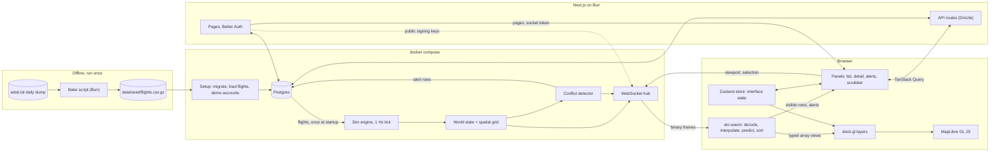
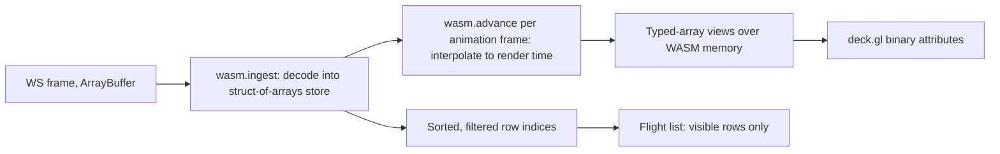
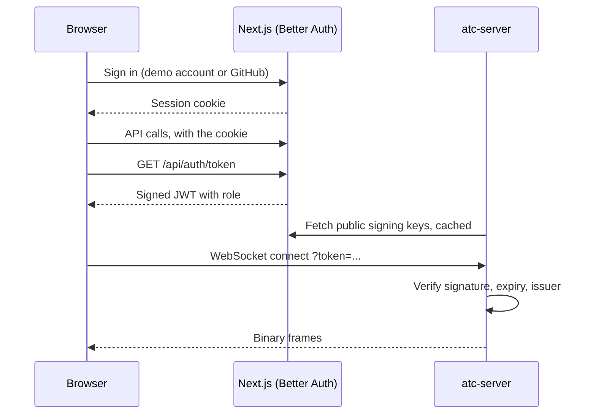

# ATC Demo: Design Document

Status: draft 4, 2026-11-24

## 1. Goals and non-goals

**Goals**

- A live traffic picture of the Boston / New York / Philadelphia / DC corridor that stays at 60 fps from a few hundred aircraft up to 50,000+.
- Go beyond a flight tracker with decision-support features: trajectory prediction with a time scrubber, conflict detection, and airspace overlays.
- 2D and 3D modes.
- Authenticated access with two roles.
- One command (`docker compose up`) starts Postgres and the real-time server, with the recorded flights loaded. The backend needs no external service at runtime. The browser still fetches map tiles from hosted services, and GitHub sign-in needs GitHub; the demo accounts do not. No account or token is needed to run it.
- Runs locally first, but stays deployable: all configuration comes from environment variables read at run time, and the images are self-contained.

**Non-goals (v1)**

- Live ADS-B ingestion. The feed interface leaves room for it.
- Operational accuracy. Separation rules and prediction are simplified.
- Instructing aircraft. The app is watch-only: aircraft always follow their recorded paths.
- Mobile layout, multi-region scaling.
- A public deployment. It is a later step, not part of v1.

## 2. Decisions

| Area | Decision | Reason |
|---|---|---|
| Data | Simulator replaying recorded real tracks | Authentic callsigns and flight paths, deterministic, works offline |
| Seed source | adsb.lol daily dumps; recording OpenSky's live state vectors as the fallback | adsb.lol carries speed, track, vertical rate and aircraft type, needs no account, and is ODbL, so the baked data can be committed with attribution. OpenSky's track endpoint lacks speed and vertical rate and its redistribution terms are unconfirmed |
| Seed data | Tracks resampled to 10 s, committed as compressed CSV under a 50 MB budget, loaded into Postgres | A fresh clone works offline; CSV needs no custom format and can be inspected; Postgres makes the tracks queryable by the web app |
| Real-time server | Rust (axum + tokio): simulator, conflict detector and the WebSocket, nothing else | The heavy, threaded work, and it shares a crate with the browser WASM module |
| API | Next.js route handlers on Bun: flights, saved views, preferences, alert history | Ordinary database reads and writes in TypeScript, on the same origin as the pages, so the session cookie is enough |
| Transport | WebSocket, binary frames server to client | Compact, viewport-filtered push; the client sends viewport changes back |
| Auth | Better Auth in Next.js, database-backed, with its admin and JWT plugins | Actively developed successor to Auth.js. Roles, demo accounts and a token the Rust server can verify are all documented features |
| Rendering | deck.gl interleaved with MapLibre GL JS, through `@deck.gl/maplibre` | Picking, trails and 3D come built in; attributes come straight from WASM memory |
| Scale | 300-800 aircraft airborne at once by default, stress multiplier to 50k+ | Realistic picture plus a provable performance story |
| Aircraft data in the browser | Held only in WASM memory | JavaScript never holds a per-aircraft object, at any scale |
| Interface state | Zustand | About a dozen fields; must be readable from the render loop and the socket client, outside React |
| Server data in the browser | TanStack Query | Caching and refetching for flights, saved views, preferences and alert history |
| Map | MapLibre GL JS v6 | Open source, with terrain, sky and extrusions, and no account or token. Mapbox GL JS's licence requires an active Mapbox account |
| Map tiles | Hosted and free: OpenFreeMap vector tiles for the base map, Mapterhorn for terrain | Neither needs registration or a key. Serving tiles from local files is left for later |
| JS tooling | Bun for installs, workspaces, scripts, tests and as the Next.js runtime | Fast installs and one tool in place of Node + pnpm |
| Web scaffold | `apps/web` starts from [bun-templates/bun-nextjs-todo](https://github.com/bun-templates/bun-nextjs-todo) | Next.js 16, React 19, TypeScript, Tailwind CSS 4, shadcn/ui, Biome and Zod, already wired to run on Bun |
| Web settings | React Compiler on, `cacheComponents` off | The template installs the compiler plugin without enabling it, and turns `cacheComponents` on; this app is live data behind a sign-in with nothing worth caching |
| Database | One Postgres in compose, one schema, owned by Drizzle in the web app | One migration tool for the application tables and Better Auth's tables. The Rust server reads the flights at startup and writes alert rows |
| Data layer | Drizzle with the `pg` driver | Typed queries and migrations; Better Auth has an adapter for it; `pg` also runs on Node |
| Offline tools | Bun scripts | Baking tracks and airspace is one-off file processing; it does not need Rust |
| Interaction | Watch-only | Keeps the simulator a pure replay, so prediction error stays measurable |
| Hosting | Local now, deployable later | Config in env vars, self-contained images |
| Web app in dev | Bare metal with `bun dev`; a production Dockerfile behind a compose profile | Fast reload and a simple WASM rebuild loop day to day, one-command start when wanted |

## 3. Architecture



Two servers, with a clear line between them:

- **`atc-server` (Rust)** is the real-time engine. It runs the simulator and the conflict detector and speaks to browsers over one WebSocket. It has no REST API beyond a health check.
- **The Next.js app** is everything else: pages, sign-in, and the API for flights, saved views, preferences and alert history.

`atc-core` is the centre of the Rust side: one crate holding the wire format, kinematics, prediction and conflict maths. It compiles natively into the server and to WASM for the browser, so both sides encode, decode and predict with the same code.

## 4. Repository layout

```
atcdemo/
  Cargo.toml              # cargo workspace
  package.json            # Bun workspaces: apps/*, packages/*, tools
  bun.lock
  docker-compose.yml      # postgres, setup, atc-server; web behind the "full" profile
  .env.example            # every variable in the table below
  LICENSE
  crates/
    atc-core/             # wire format, kinematics, prediction, conflicts; no I/O
    atc-server/           # sim engine, conflict detector, WebSocket hub
    atc-wasm/             # wasm-bindgen wrapper around atc-core
  apps/
    web/                  # Next.js (App Router), TypeScript
      app/api/            # route handlers: auth, flights, views, preferences, alerts
      db/                 # Drizzle schema, migrations, setup script
  packages/
    atc-wasm/             # wasm-pack output, not committed
  tools/                  # Bun scripts: bake tracks, bake airspace
  data/
    README.md             # sources, dates, licences and attribution
    seed/                 # baked flights, committed
    airspace/             # Class B and ARTCC boundary GeoJSON
  docs/DESIGN.md
```

**Running it.**

- `docker compose up` starts Postgres, runs a one-shot `setup` service, then starts `atc-server`. Setup applies the Drizzle migrations, loads the flights if the table is empty, and creates the demo accounts. The web app runs alongside with `bun dev`, outside Docker, so hot reload and the WASM rebuild loop stay native.
- `docker compose --profile full up` also builds and runs the web app from `apps/web/Dockerfile`, for a hands-off demo or a deploy rehearsal. That image needs a Rust and `wasm-pack` build stage and the repo root as its build context.

**Bun.** Bun replaces Node and pnpm: `bun install` for workspaces, `bun run` for scripts, `bun test` for unit tests, and `bun --bun next dev` to run Next.js on the Bun runtime. `apps/web` is scaffolded from the `bun-nextjs-todo` template, whose scripts already use `bun --bun next`. Its todo actions, components and compose file are deleted. Drizzle, Zustand, TanStack Query, TanStack Virtual, MapLibre GL JS, deck.gl and Better Auth are added on top.

The template reaches Postgres through Bun's built-in SQL client. This app uses Drizzle over the `pg` driver instead, which also runs on Node. Next.js is built for Node first, so if a Next.js or Better Auth feature misbehaves under the Bun runtime, the fallback is to keep Bun as the package manager and run Next.js on Node. Nothing else in the design depends on which runtime serves the web app.

**React Compiler.** Enabled in `next.config.ts`. The components that own the map and the deck.gl overlay mutate imperative objects, so they opt out with `"use no memo"`.

**WASM package.** `bun run wasm:build` runs `wasm-pack build crates/atc-wasm --target web --no-pack` and writes to `packages/atc-wasm`. The output is not committed, so a fresh clone, CI and the web image all build it, and each needs a Rust toolchain and `wasm-pack`. The root `dev` and `build` scripts run it first. `bun run wasm:watch` rebuilds on every change under `crates/atc-core` and `crates/atc-wasm`, and `next dev` serves the rebuilt module on the next page load.

The milestone 1 spike settled how the web app loads it (wasm-pack 0.15.1, wasm-bindgen 0.2.130, Next.js 16.3.1):

- **No `package.json` in the output.** `--no-pack` leaves it out, so `packages/atc-wasm` is not a workspace package. `bun install` and `bun.lock` therefore do not depend on whether the WASM has been built. The web app finds the module through a `paths` entry in its `tsconfig.json`, which maps `atc-wasm` to the generated `atc_wasm.js`; Turbopack follows it, and the generated `.d.ts` gives the types.
- **Client-only import, explicit `init()`.** A client component calls `await import("atc-wasm")` inside an effect and then awaits the module's default export. The generated code locates the `.wasm` file with `new URL("atc_wasm_bg.wasm", import.meta.url)`, which Turbopack treats as an asset: it is emitted with a hashed name and fetched by the browser. Nothing WASM-related runs during prerendering.
- **Zero-copy views work.** `init()` returns the module's `memory`. Rust hands out a pointer and a count, and JavaScript wraps them in a typed array over `memory.buffer` with no copy.
- **`turbopack.root` is set to the repo root** in `next.config.ts`. Next.js already infers that root from `bun.lock`, so the setting is a safeguard: it keeps resolution working if the lockfile detection ever changes.
- It works the same under `next dev` and in a production build, and needed no loader configuration and no experimental flags.

**Configuration.** Everything is an environment variable read at run time. No value is baked into an image: the socket URL is read by the Next.js server on each request and passed to the page. Names may change during the build; `.env.example` is the authority.

| Variable | Read by | Purpose |
|---|---|---|
| `DATABASE_URL` | atc-server, web, setup | The one Postgres database |
| `ATC_STRESS_MULTIPLIER` | atc-server | Clone multiplier at startup, default 1 |
| `ATC_ALLOWED_ORIGIN` | atc-server | The web app's origin; socket connections from anywhere else are refused |
| `ATC_JWKS_URL` | atc-server | Where to fetch Better Auth's public signing keys |
| `ATC_AUTH` | atc-server | `off` treats every connection as a fixed dev user; for tests, the CLI client and milestones 2-3 |
| `BETTER_AUTH_SECRET`, `BETTER_AUTH_URL` | web | Session signing and the app's public URL |
| `GITHUB_CLIENT_ID`, `GITHUB_CLIENT_SECRET` | web | Optional. GitHub sign-in is offered only when both are set |
| `CONTROLLER_GITHUB_USERS` | web | GitHub usernames that become `controller` when their account is created |
| `DEMO_VIEWER_PASSWORD`, `DEMO_CONTROLLER_PASSWORD` | setup | Passwords for the two demo accounts |
| `ATC_WS_URL` | web | Where the browser reaches `atc-server` |

## 5. Seed data and the simulator

**Baking (a Bun script in `tools/`, offline).** Download one day of adsb.lol's world dump, keep the aircraft that pass through the corridor bounding box (roughly 38°N to 43.5°N, 78°W to 69.5°W) during a 4-6 hour window, split each aircraft's trace into flights, and resample to a fixed 10 s interval. Write `data/seed/flights.csv.gz` with one row per flight: ICAO24, callsign, type, origin and destination where known, start time within the window, and the waypoints as array columns (lat, lon, altitude, ground speed, track, vertical rate, on-ground). The dump has no origin or destination, so those are left empty in v1.

The window holds several thousand flights, of which 300-800 are airborne at any moment. The script fails if the output exceeds 50 MB; the estimate is well under that. If the real file is too large, shorten the window first, then widen the spacing to 15 s.

**Loading.** The setup service copies the file into the `flights` table, one row per flight with the waypoints as Postgres arrays. `atc-server` reads the whole table once at startup and runs from memory after that; it never queries per tick. If the table is missing or empty it waits and says so in its log.

Live positions are never written to the database. They exist only in the simulator's memory and on the socket.

**Fixture.** Rust tests and early milestone 2 work use a small generated set of a few dozen synthetic flights, so they need neither the download nor a database.

**Replay.** The sim engine advances a clock at 1 Hz and interpolates each active flight along its recorded waypoints.

- Sim time only moves forward for as long as the server runs. The position in the recording is sim time modulo the window length.
- Each trip through the recording is a pass. A flight coming round again is a new aircraft with a new id, so trails, selection and alerts never carry over from one pass to the next.
- Flights cut by the window edges appear and vanish mid-air at the start and end of the recording. That is accepted.
- At multiplier 1 the whole picture empties and refills when the window ends. The server marks the first frame of a new pass and the client shows a brief "replay restarted" notice.

**Stress mode.** A multiplier clones flights with a time shift, a small sideways offset and the synthetic flag set. Time shifts are spread across the whole window, so clones wrap at different moments and the picture never visibly restarts at high multipliers. Multiplier 1 is the real picture; 100 gives 50k+ aircraft airborne. The multiplier is set at startup from `ATC_STRESS_MULTIPLIER` from milestone 2, so every later milestone can be run at 50k as it is built. Changing it at run time comes in milestone 8.

**Feed interface.** The engine sits behind a `Feed` trait so a live adapter can replace it later.

## 6. Wire protocol

`atc-server` exposes one WebSocket and `GET /healthz`. Everything else the browser needs comes from the Next.js API in section 7.

**Client to server** messages are small JSON text frames:

- `hello {protocol}`: the protocol version the client speaks. The server closes the socket with a distinct code on a mismatch.
- `viewport {bbox, zoom}`: sent, debounced, whenever the map moves.
- `select {id}`: the selected aircraft, or null. A selected aircraft keeps streaming after it leaves the viewport.
- `set_multiplier {value}`: changes the stress multiplier. Refused unless the connection's role is `controller`.

**Server to client** traffic is binary. The server also sends two small JSON text messages: `sim {multiplier, windowSeconds}` on connect and whenever the multiplier changes, and `error {code, message}` when it refuses a request.

Binary frames are little-endian with a 24-byte header. Every field sits on its natural alignment, so the client can read frames through typed-array views.

| Offset | Field | Type | Notes |
|---|---|---|---|
| 0 | version | u8 | |
| 1 | kind | u8 | positions, metadata, alerts |
| 2 | record size | u16 | bytes per record; lets a client skip fields it does not know |
| 4 | seq | u32 | per connection |
| 8 | sim time | f64 | milliseconds, never decreases |
| 16 | count | u32 | |
| 20 | flags | u32 | bit 0: first frame of a new pass |
| 24 | records | count × record size | |

Position record, 20 bytes:

| Offset | Field | Type | Unit |
|---|---|---|---|
| 0 | id | u32 | aircraft id |
| 4 | lat, lon | i32 × 2 | 1e-7 degrees |
| 12 | altitude | i16 | 25 ft; signed, since barometric altitude at coastal airports goes below zero |
| 14 | ground speed | u16 | knots |
| 16 | track | u16 | 360/65536 degrees |
| 18 | vertical rate | i8 | 64 ft/min, the resolution ADS-B itself reports; clamped to ±8,128 |
| 19 | flags | u8 | bit 0 on ground, bit 1 synthetic |

Metadata record, 40 bytes: aircraft id (u32), flight id (u32), ICAO24 (u32), time shift in seconds (u32), sideways offset east and north in metres (i16 × 2), then space-padded ASCII for callsign (8), type (4), origin (4) and destination (4).

Alert record, 36 bytes: both aircraft ids (u32 × 2), both positions (i32 × 4), both altitudes (i16 × 2), seconds to closest approach (u16), predicted lateral distance in 0.01 nm (u16), predicted vertical separation in 25 ft (u16), flags (u16).

**Two kinds of id.**

- The **flight id** is the row in the `flights` table: one recorded flight. The web API is keyed by it.
- The **aircraft id** is allocated by the simulator for one flight, one clone and one pass, and is unique for the life of the server process. Position and alert records use it.
- The metadata record links the two. It also carries the aircraft's time shift, so the browser can place it on the recording's clock: recording time is sim time minus the shift.
- ICAO24 identifies an airframe, which can fly several legs in the window, so it is descriptive data and not a key.

**Frames are snapshots, so a skipped frame loses nothing.**

- A positions frame lists every aircraft in the client's viewport plus a margin, found through the spatial grid, plus the selected aircraft. The client drops any aircraft absent from the newest frame; there is no removals message.
- An alerts frame lists every active alert with either aircraft in the viewport. It carries both positions, so the link can be drawn when one end is off screen. It is capped at 500 records, soonest closest approach first.
- A metadata frame lists aircraft the client has not yet been told about. An aircraft counts as told only once its frame has been written to the socket, so a frame that is replaced before sending leaves its aircraft pending for the next one.
- A gap in `seq` therefore needs no resync. The client counts gaps for the performance HUD.

**Frame size.** At 20 bytes per aircraft a whole-corridor frame at 50k is 1 MB per second. That is accepted in v1; there is no zoom-based thinning. Viewport filtering helps only when zoomed in.

**Slow clients.** Each connection gets a latest-wins slot, not a queue. A client that falls behind skips frames and never builds a backlog.

## 7. Web API

Next.js route handlers, on the same origin as the pages. Every route requires a signed-in session, read from the cookie; there are no bearer tokens and no cross-origin rules. Inputs are validated with Zod, queries go through Drizzle, and the browser calls them through TanStack Query.

| Route | Purpose |
|---|---|
| `/api/auth/*` | Better Auth: sign-in, sign-out, session, the socket token and the public signing keys |
| `GET /api/flights?search=` | Find recorded flights by callsign |
| `GET /api/flights/:id` | One flight's metadata and its whole recorded track |
| `GET`, `POST /api/views`; `PUT`, `DELETE /api/views/:id` | Saved views, visible only to their owner |
| `GET`, `PUT /api/preferences` | The signed-in user's preferences |
| `GET /api/alerts` | Alert history, paged by wall-clock time |

**Tracks and "now".** `GET /api/flights/:id` returns the whole track, past and future, on the recording's clock. Neither Next.js nor Postgres knows what any browser is looking at. The browser works out where "now" is from the sim time in each frame and the aircraft's time shift from its metadata. Waypoints before that point are the trail; those after it are the true future, used only to measure prediction error. For a stress-mode clone the browser also applies the sideways offset.

A recorded flight never changes, so each track is fetched once and cached for the session, and the trail grows without refetching as sim time advances.

## 8. Client data path



- **The WASM store** is a block of memory inside the browser tab, owned by the Rust code. It holds the last two samples of each aircraft the server has sent this client, plus its metadata. It is rebuilt from the socket on every page load and is a few megabytes at 50k.
- JavaScript never holds per-aircraft objects. The flight list asks WASM for the rows on screen (about 30), WASM does the sorting and filtering and returns row indices, and callsigns become JavaScript strings only for visible rows. A counter bumped once a second tells React to re-read, through `useSyncExternalStore`.
- **Interface state** lives in a Zustand store: selected and hovered aircraft, filters and sort order, 2D or 3D, vertical exaggeration, layer toggles, scrubber position, connection status, performance readings, and the current alerts (bounded by the 500-record cap). The render loop and the socket client read it directly.
- **Server data** (flights and tracks, saved views, preferences, alert history) goes through TanStack Query to the web API.
- Rendering runs about one update behind the newest frame and interpolates between the last two samples, so motion is smooth at a 1 Hz feed. If a frame is late it extrapolates by dead reckoning. When a hidden tab becomes visible again it snaps to the newest frame.
- **Socket client.** Fetches a token, connects, sends `hello` and viewport changes, hands frames to `wasm.ingest`, and reconnects with backoff. Each reconnect fetches a fresh token; if the session has ended it redirects to sign-in.
- deck.gl reads its attributes as typed-array views directly over WASM memory. There is no per-frame JavaScript allocation and no garbage; deck.gl still uploads the buffers to the GPU once per frame, about 1 MB at 50k.

| Attribute | Layout | Notes |
|---|---|---|
| position | f32 × 3 | lon, lat, altitude. Float32 resolves to under a metre at this longitude, which is enough for icons |
| angle | f32 | degrees counter-clockwise, so the negative of track |
| colour | u8 × 4 | altitude band |
| icon | none | one icon for every aircraft in v1, so no per-aircraft accessor runs |

- Views are checked every frame and recreated when WASM memory grows, because a detached view reports length zero without raising an error.
- Picking returns a row index, which WASM maps to an aircraft id. Selection is always by id.
- WASM runs on the main thread in v1. Moving it to a worker needs SharedArrayBuffer and cross-origin isolation headers; do that only if profiling calls for it.
- A performance HUD shows fps, frame-time percentiles, WASM advance time, attribute update time, aircraft count, bytes per second and skipped frames. A toggle switches to a plain-JavaScript implementation of the same path for a side-by-side comparison.

## 9. Rendering and 3D

deck.gl's `MapLibreOverlay` in interleaved mode on MapLibre GL JS v6, so layers depth-sort with the map's own scene. Interleaving needs WebGL2. The base map is an OpenFreeMap vector style; terrain comes from Mapterhorn's elevation tiles.

| Layer | Purpose |
|---|---|
| IconLayer | Aircraft, rotated by track, coloured by altitude band |
| PathLayer | Trail for selected and hovered aircraft |
| LineLayer | Prediction vectors; conflict pair links |
| ScenegraphLayer | 3D aircraft models at close zoom in 3D mode |
| LineLayer (3D) | Stems dropping from each aircraft |
| Extruded polygons | Class B shelves with floor and ceiling |
| MapLibre line layer | ARTCC boundaries |

Rules that follow from how deck.gl and MapLibre interact:

- The map stays on the mercator projection. deck.gl's support for MapLibre's globe is experimental and does not draw flat icons.
- deck.gl layers are placed in the map's layer stack with the `beforeId` property.
- The map is created with antialiasing on; MapLibre turns it off by default, and path and line layers look jagged in interleaved mode without it.
- deck.gl layers are not draped over terrain: data at height zero renders at sea level. Stems therefore end at sea level and disappear into high ground. That is accepted.
- Vertical exaggeration is one value in the interface store. Terrain, aircraft height and airspace floors and ceilings all read it, so they stay in step.

3D mode pitches the camera, turns on terrain and sky, and places aircraft at altitude with an adjustable vertical exaggeration (the corridor is about 700 km long and cruise is about 11 km high, so true scale looks flat).

## 10. Decision-support features

**Trajectory prediction.** `atc-core` projects each aircraft forward from its current state only (position, track, speed, vertical rate, levelling off at a plausible cruise or field altitude). It runs in WASM so the scrubber is instant.

Because the simulator replays recorded tracks, the true future is known. The detail panel shows prediction error against what actually happened, using the recorded track from the web API, which is an honest measure of the predictor.

**Time scrubber.** Dragging the timeline shows the predicted picture up to 20 minutes ahead.

- Prediction is taken from the moment scrubbing starts and is not re-anchored as new frames arrive, so the predicted picture does not jitter.
- Live aircraft are hidden. The list and the detail panel show predicted values.
- Conflict links are drawn between the predicted positions at the scrubbed time.
- A banner states that the picture is a prediction, and a "Return to live" button leaves the mode.

**Conflict detection.** The server runs it every 5 seconds on a snapshot of world state, off the main loop: a grid broad phase banded by altitude, then closest point of approach on predicted paths. Pairs predicted to come within 5 nm laterally and 1,000 ft vertically inside a 5-minute look-ahead produce an alert.

- En-route traffic only. Aircraft on the ground or below 10,000 ft are skipped, which removes taxiing aircraft and parallel approaches.
- Pairs cloned from the same recorded flight are skipped; they fly in trail by construction.
- An alert is keyed by its ordered pair of aircraft ids. It is raised on first detection, updated on each pass of the detector, and cleared after two passes without detection.
- Alerts involving a synthetic aircraft are shown but not saved.
- Open alerts are closed when a replay pass ends and when the server starts.

The map links the pair and the alerts panel lists them by time to closest approach.

**Airspace overlays.** Class B shelves for Boston, New York, Philadelphia and Washington as extruded volumes, and the boundaries of the Boston, New York and Washington ARTCCs as lines, from FAA open data baked to GeoJSON by a Bun script. Class C is left out. Sector boundaries inside each ARTCC are added only if they turn out to be published as open data.

**Flight list and detail.** A virtualised, sortable, filterable table of the aircraft in view, synced with map selection in both directions. The detail card shows route, altitude profile and speed. The trail is fetched for the selected aircraft, and for a hovered one after a short delay.

**Flight search.** A search box finds any flight in the recording by callsign, whether or not it is airborne. Choosing a result shows its recorded track on the map; if that flight is currently in view, it is also selected.

## 11. Authentication



Better Auth runs in the Next.js server and keeps accounts and sessions in Postgres, through its Drizzle adapter.

- **Sign-in.** Email and password for two demo accounts created by the setup service, one per role, so the app works without any OAuth setup. GitHub sign-in is offered when its client id and secret are configured.
- **Roles.** `viewer`, and `controller`, which may change simulator settings. The admin plugin stores the role on the user record. GitHub users start as `viewer`, except usernames listed in `CONTROLLER_GITHUB_USERS`, which are created as `controller`.
- **The web API uses the session cookie.** Pages and API routes share an origin, so nothing else is needed.
- **The socket uses a token.** Browsers cannot set headers on a WebSocket, and `atc-server` has no access to the session. The JWT plugin issues a short-lived token carrying the user id and role, which the browser fetches just before connecting and sends in the query string. `atc-server` redacts it from its logs.
- **Verification.** The JWT plugin publishes the public keys it signs with. `atc-server` fetches them from `ATC_JWKS_URL`, caches them, and refetches when it sees an unknown key id. There is no shared secret. The token's role claim is the only authority on the Rust side.
- **Checked at connect only.** A sign-out or role change takes effect at the next connection.
- **Origin check.** `atc-server` refuses socket connections whose origin is not `ATC_ALLOWED_ORIGIN`.
- **Route protection.** Unauthenticated visits redirect to the sign-in page, through Next.js 16's `proxy.ts`.
- **Development.** With `ATC_AUTH=off` the server skips verification and treats every connection as a fixed dev user. It logs a warning at startup when the switch is set.

In the default setup `atc-server` runs in Docker and the web app on the host, so `ATC_JWKS_URL` points at the host; under the `full` profile it points at the web container.

## 12. Persistence

One Postgres runs as a compose service, with one schema. Drizzle, in the web app, owns every table and every migration.

| Table | Written by | Contents |
|---|---|---|
| Better Auth's tables | Next.js | Users with their role, accounts, sessions, signing keys |
| `flights` | Setup service | One row per recorded flight: ICAO24, callsign, type, origin and destination where known, start time within the window, and the waypoints as array columns at 10 s spacing |
| `saved_views` | Next.js | Per-user named camera positions, 2D/3D mode, filters |
| `preferences` | Next.js | Per-user units, vertical exaggeration, layer visibility |
| `alerts` | atc-server | Conflict history: the two flights, predicted time and distance of closest approach, wall-clock times raised and cleared, sim time, pass number |

`atc-server` touches two tables: it reads `flights` once at startup and writes `alerts`. It uses sqlx with queries checked at run time. At startup it verifies that the columns it needs exist and stops with a clear message if they do not, because a schema change on the TypeScript side cannot fail the Rust build.

The same conflicts recur on every pass, so `atc-server` deletes alert rows older than three days.

## 13. Testing

- **Unit tests** live beside the code: `cargo test` for the crates, `bun test` for the web app and tools.
- **Wire format.** Encode and decode round-trip tests in `atc-core`, covering every frame kind.
- **Parity.** One test runs decode and prediction natively and in WASM on the same input and compares the results, since "the same code on both sides" is the central claim.
- **Server integration.** A test starts the hub in process on the fixture feed and connects a real WebSocket client. It asserts viewport filtering, metadata delivery, latest-wins behaviour, token rejection and the `controller` check on `set_multiplier`.
- **Database.** Tests for the API routes, the flights loader and the server's reads and writes run against a real Postgres in CI. One test shows a user cannot read another user's views.
- **End to end.** One Playwright smoke test from milestone 4: sign in with a demo account and see aircraft on the map.
- **Performance.** Benchmarks for encode, grid filtering and the conflict pass, and a fixed-camera benchmark page for the browser targets in section 15.
- **CI** runs formatting, linting and all of the above on pull requests, and builds the WASM package, the web app and the Docker images.

## 14. Licences and attribution

- **Code.** MIT; see `LICENSE` at the repo root. The data and assets below keep their own terms.
- **Seed tracks.** adsb.lol data is under the ODbL 1.0, which requires attribution and that the derived database stays under the same terms. `data/README.md` records the source, the date and window baked, and the licence notice.
- **Airspace.** FAA open data; the source and its terms are confirmed by the milestone 2 spike and recorded in the same file.
- **Map.** MapLibre GL JS is BSD-licensed. The base map needs on-screen attribution to OpenFreeMap, OpenMapTiles and OpenStreetMap, which MapLibre adds automatically, and the terrain needs attribution to Mapterhorn's sources.
- **Aircraft icon and 3D model.** Drawn for the project or taken from sources whose licences allow redistribution, and recorded in the same file.

## 15. Milestones

Each milestone ends with a condition that can be checked.

1. **Scaffold.** Bun and cargo workspaces, compose file with Postgres and the setup service, Drizzle, configuration, CI, and two spikes: Better Auth on Next.js 16 and Bun, and a WASM module loaded in the Next.js page.
   *Done when:* from a fresh clone with `.env` copied from `.env.example`, `docker compose up` gives a migrated Postgres and `GET /healthz` returns 200; `bun install && bun dev` serves a page that calls into WASM; CI passes on a pull request; both spike outcomes are written into this document.
2. **Seed, sim and socket.** Bake script, the seed file and its loader, sim engine with the startup multiplier, WebSocket hub, a CLI client, and the airspace data spike.
   *Done when:* using only committed files, `docker compose up` loads the flights and the CLI client shows 1 Hz frames with 300-800 aircraft for the whole corridor, fewer after a narrower viewport, metadata for every aircraft, and a clean pass boundary; at multiplier 100 it shows 50,000+ and the server tick meets its target; the integration test passes in CI.
3. **Map and WASM path.** Socket client, WASM store and interpolation, map, 2D aircraft layer with picking, performance HUD, app shell.
   *Done when:* the browser shows smoothly moving aircraft at multiplier 1; panning changes which aircraft arrive; a HUD reading at 50k is recorded; CI builds the WASM package and the web app.
4. **Auth.** Sign-in, roles, route protection, and token verification on the socket.
   *Done when:* an unauthenticated visit redirects to sign-in; a socket connection with a missing, expired or forged token is refused (tested); demo sign-in works with no GitHub configuration; the CLI client still works; the smoke test passes.
5. **Lists, detail and persistence.** Flight list, flights API and search, detail panel, trails, saved views, preferences, layer and unit controls.
   *Done when:* selecting in the list highlights on the map and the reverse; the list stays responsive at 50k; a trail and detail load for a real aircraft and for a clone; a saved view and preferences survive a restart; a test shows one user cannot read another's views.
6. **3D and airspace.** 3D mode, stems, aircraft models, Class B volumes, ARTCC boundaries.
   *Done when:* a toggle switches between 2D and 3D; aircraft sit at altitude and stay in step with the airspace volumes as exaggeration changes; all four Class B areas render with the right floors and ceilings; mode and exaggeration persist.
7. **Prediction and conflicts.** Prediction, time scrubber, prediction error, conflict detector, alerts panel and alert history.
   *Done when:* scrubbing to +20 minutes holds 60 fps at multiplier 1; a known conflict in the fixture raises an alert, shows in the panel with a pair link, clears, and leaves a row with both times; the conflict pass meets its target at 50k; the parity test passes.
8. **Stress mode.** Changing the multiplier at run time with a `controller`-only control, the plain-JavaScript path, and the measured results.
   *Done when:* a `controller` can change the multiplier from the UI and a `viewer` is refused; a results table is committed covering every target below, for both the WASM and JavaScript paths, naming the hardware and browser.
9. **Web container.** Web app Dockerfile and the `full` compose profile.
   *Done when:* on a machine with only Docker, a fresh clone plus `.env` and `docker compose --profile full up` leads to a demo sign-in and the live map; the README's run instructions are no longer marked as planned.

**Performance targets**, measured on an M-series laptop in Chrome with a fixed whole-corridor camera in 2D, all 50,000 aircraft in view and picking on:

| Measure | Target |
|---|---|
| Frame time, 95th percentile | 16.7 ms or less (60 fps) |
| WASM advance per frame | under 2 ms |
| Server tick: advance the sim and build one whole-corridor frame | under 100 ms |
| Conflict pass | under 1 s |

The HUD also reports the split of main-thread time between WASM, deck.gl attribute updates and map rendering, because the base map is often the real limit. If the plain-JavaScript path turns out to be as fast as WASM, the results table says so.

## 16. Open questions

The design decisions are made. These need checking during the build, and each is owned by a spike or an issue in the milestone named:

1. **Better Auth on Next.js 16 and Bun** (milestone 1). Confirm the Drizzle adapter, the admin plugin's roles, the JWT plugin's token and key endpoint, and the `pg` driver under Bun. Fallbacks: run Next.js on Node; Auth.js v5 if Better Auth itself does not fit.
2. **WASM under Turbopack** (milestone 1). Resolved: the approach in section 4 works with `wasm-pack` as it stands, in dev and in a production build. `wasm-bindgen`'s own CLI was not needed.
3. **adsb.lol download** (milestone 2). The size of a day's dump, the cost of filtering it, and the real size of the baked file.
4. **Airspace data** (milestone 2). The FAA source and terms for Class B and ARTCC boundaries, and whether sector boundaries are published.
5. **deck.gl binary attributes at 50k** (milestone 3). Confirm that a single shared icon avoids per-aircraft accessor calls and that the frame-time target is reachable with picking on.
6. **Hosted tile terms** (milestone 3). OpenFreeMap's terms of service and whether Mapterhorn states usage limits, and which OpenFreeMap style suits a traffic display.
7. **Airspace volumes over terrain** (milestone 6). MapLibre's fill-extrusion against a deck.gl polygon layer: whichever keeps floors and ceilings correct over high ground and follows the shared exaggeration. MapLibre's docs do not say how fill-extrusion behaves with terrain on.

## 17. Possible later work

- What-if instructions: try a heading or altitude change on one aircraft and see the predicted picture and conflicts update, on the user's own screen only.
- Real instructions that change the shared simulation, which needs a flight model in the simulator.
- A live ADS-B feed adapter behind the `Feed` trait.
- Origin and destination for each flight, from a second dataset.
- Sector boundaries, if no open source is found for v1.
- Conflict detection in terminal airspace, with tighter separation below 10,000 ft.
- An admin screen for changing roles.
- Map and terrain tiles served from local files, so the demo runs with no network.
- MapLibre's WebGPU renderer, once it ships and deck.gl can share it.
- A public deployment.
